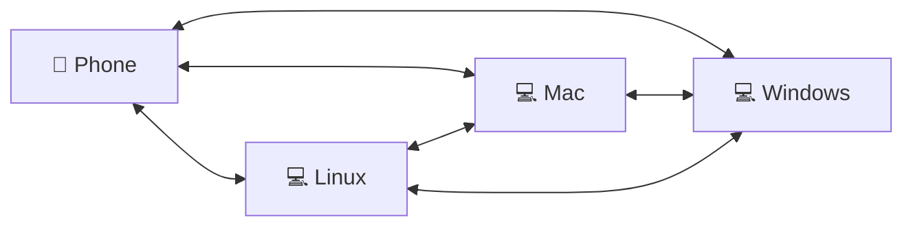

# Clipboard Bridge

One clipboard for your phone and every computer at home: copy on one, paste on another.
Android, iPhone, Linux, Windows and Mac, on your own network, with no cloud and no
accounts. Its command is `cbb`.

> **Status: early development.** What works, and what has been tried on real devices, is
> in the [status table](#status) below.



## Get started

1. Install the app on your phone (Android: the APK in the
   [latest release](https://github.com/HunterEwok/clipboardbridge/releases/latest); iPhone:
   TestFlight, coming).
2. Install Clipboard Bridge on a computer:

   ```sh
   # Linux and Mac
   curl -fsSL https://github.com/HunterEwok/clipboardbridge/releases/latest/download/get.sh | sudo sh
   ```

   ```powershell
   # Windows 10 or 11, in an administrator PowerShell
   irm https://github.com/HunterEwok/clipboardbridge/releases/latest/download/get.ps1 | iex
   ```

3. Run `sudo cbb pair` on the computer and scan its QR code in the app.

The [quick start](docs/guide/quickstart.md) walks through it step by step;
[Installing](docs/guide/install.md) has Homebrew, winget, Docker and the firewall.

## What it does

| From → to | What you do |
|---|---|
| Computer → computer | Copy on one, paste on another. Automatic. |
| Computer → Android | Copy on the computer, paste on the phone. Automatic. |
| Android → computer | Copy on the phone; sent by itself with the accessibility service, or with one tap. |
| Computer ↔ iPhone | One press of the Action button or a double tap on the back, then paste. |

iOS does not let apps read the clipboard in the background, so the iPhone needs one
gesture. Apple devices on one Apple Account already share a clipboard; Clipboard Bridge
connects them to everything else. On Linux it works with any desktop, and without one
through tmux and `cbb copy` and `cbb paste`.

## Principles

- **Your network only.** At home the devices talk to each other directly. Away from home
  they reach a computer of yours at home through the group's own encrypted tunnel
  ([how it works](docs/guide/how-it-works.md)). No cloud, no accounts, no telemetry.
- **Encrypted and paired.** All traffic uses TLS. A device joins your group once, by a QR
  code or a six-digit code, and talks only to the devices of the group.
- **The key stays on the phone.** In a group made on a phone, the phone holds the group's
  key in its security chip and admits every device.
- **Small.** One file per platform, no dependencies; runs on a Raspberry Pi Zero W.
- **Passwords stay put.** Items that password managers mark as secret are not synced
  automatically.

## Platforms

| Platform | Component |
|---|---|
| Linux: Ubuntu, Raspberry Pi OS and other distributions; x86-64, ARM64, ARMv7, ARMv6 | service, desktop connector, console helper, tray app |
| macOS | service, pasteboard agent, Mac app |
| Windows 10 (1809 or later) and 11; x86-64, ARM64 | service, clipboard agent, tray app |
| Android | the app (an APK in every release) |
| iOS and iPadOS | the app, or a shortcut in the Shortcuts app |
| Apple Watch, Wear OS | a watch app, through the phone |
| Small Linux devices (routers, boards) | the lite member, also `cbb` ([lite/README.md](lite/README.md)) |

## Status

| Part | State | On real devices |
|---|---|---|
| Linux service, desktop clipboard (X11, Wayland), tmux, `cbb copy`/`paste` | works | yes (Raspberry Pi, Steam Deck) |
| macOS service and pasteboard agent | works | yes |
| Windows service, clipboard agent, installer | built, CI on windows-latest | not yet |
| iPhone shortcut (Action button, Back Tap) | works | yes |
| iPhone app (the phone as the root, admin phones, devices list) | built, CI on a simulator | not yet |
| Android app | built, CI; APK in every release | not yet |
| Apple Watch and Wear OS apps (devices, events, away switch) | built, CI | not yet |
| Lite member on Linux | built, CI e2e with Go members | joined a group on a Pi Zero W |
| Lite member on the ESP32 | protocol core and TLS build for the chip; no firmware | no |
| Sync away from home between computers (`cbb global`, `cbb invite`) | built | not yet |
| Sync away from home for the phones and the lite member | built | not yet |
| The phone as the hub, several hubs, a public blind relay | planned for 0.5 | |
| Console paste on a key press | planned | |
| Homebrew | set up; the tap gets its first formula with the next release | not yet |
| Signed macOS `.pkg`, TestFlight, app stores | planned (needs an Apple developer account) | |

The order of what comes next is the [roadmap](docs/roadmap.md).

## Documentation

- **Using it**: the [quick start](docs/guide/quickstart.md), [how it works](docs/guide/how-it-works.md)
  (with pictures), [installing](docs/guide/install.md), [away from home](docs/guide/away-from-home.md),
  [networks that block VPNs](docs/guide/blocked-networks.md), [the apps](docs/guide/apps.md),
  [without the app](docs/guide/without-app.md) and [troubleshooting](docs/guide/troubleshooting.md).
- **Reference**: [commands](docs/reference/cli.md), [devices, ports and files](docs/reference/devices.md),
  [running your own servers](docs/reference/self-hosting.md), the [lite member](lite/README.md).
- **For developers**: the [design](docs/design.md), the [protocol](docs/protocol.md) and the
  rest in the [documentation index](docs/README.md).

## License

Clipboard Bridge is free software, licensed under the
[GNU Affero General Public License v3.0 only](LICENSE).

## Security

To report a vulnerability, follow [SECURITY.md](SECURITY.md). Please do not open a public issue.

## Contributing

Bug reports and ideas are welcome as issues. Code contributions are not accepted at this time;
see [CONTRIBUTING.md](CONTRIBUTING.md).
