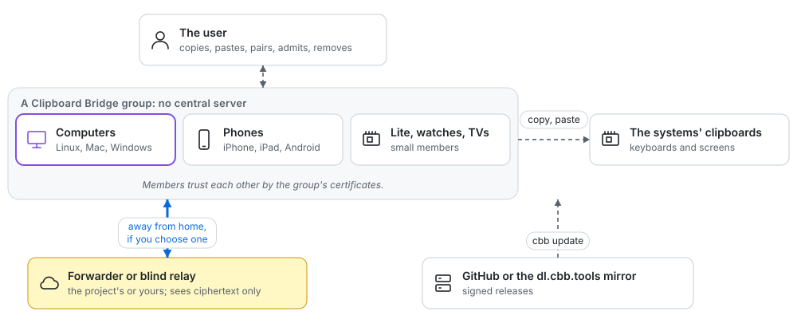
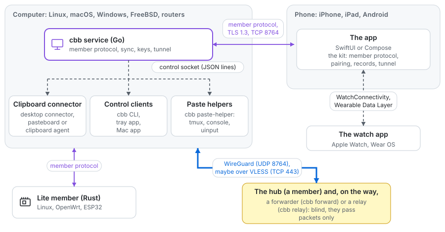

# Design

For engineers: how Clipboard Bridge works and why, as built. The document follows the
[arc42](https://arc42.org/overview) template, so each kind of question has a fixed place:
the goals and constraints first, then the context, the building blocks, how they work at run
time and where they run, then the concepts that cut across them, the decisions, the quality
requirements and the risks. The wire format is in [protocol.md](protocol.md), what comes
next in [roadmap.md](roadmap.md), the decisions in [decisions.md](decisions.md), and the
threats with their defences in [threat-model.md](threat-model.md).

## 1. Introduction and goals

Clipboard Bridge gives one person's devices one clipboard, without a cloud. This part says
what it must do and what it deliberately does not.

### Quality goals

In order of priority, when two of them conflict:

1. **Security.** Only the group's own devices read a copy. Every connection is mutually
   authenticated TLS 1.3 under the group's certificates; joining needs the user at both
   devices; a lost device is removed in one step.
2. **Privacy.** No accounts, no telemetry, no server that reads the clipboard. The servers a
   group may use away from home (a forwarder, a blind relay) learn as little as the
   protocol allows (see "Sync away from home").
3. **Reliability.** Any device may be off at any time; the others keep syncing, and a device
   that comes back converges on the group's newest copy.
4. **Ease.** A copy arrives on the others within seconds (the bench's rule is 10 s), with
   each system's usual copy and paste; adding a device takes a QR code or a six-digit code.
5. **Portability.** The same protocol from a Raspberry Pi Zero W, a router or an ESP32 to a
   workstation, a phone and a watch.

### Goals

- One clipboard for the user's phones (iPhone and Android), watches and TVs, Macs, Windows
  PCs, Linux and FreeBSD machines, routers and small boards on one home network, and away
  from home through the group's own encrypted tunnel.
- Copy and paste with the normal means of each system, and at most one press on the iPhone.
- Linux with and without a desktop, from a Raspberry Pi Zero W to a workstation, without
  depending on a particular distribution or desktop.
- Encrypted and paired; no cloud, no accounts, no telemetry.

### Non-goals

- Sync through anyone else's servers or services. Away from home, devices reach the group
  only through its own tunnel (see "Sync away from home").
- Working around iOS. iOS lets an app read the clipboard only after a user action.
- Sync between Apple devices. Universal Clipboard already does it.
- Clipboard history.

## 2. Constraints

What the design cannot choose:

- **iOS** lets an app read and write the clipboard only in the foreground, and keeps no
  network connection of an app in the background, so the iPhone syncs while its app runs, at
  one gesture, and is a hub only while it is open.
- **Android** gives the clipboard in the background only to the input method or an
  accessibility service, so the app uses its accessibility service to send by itself.
- **macOS** lets only an app with the Accessibility permission press keys, and asks the user
  before a program reaches the local network; the service therefore runs as a LaunchDaemon,
  and remote paste goes through the Mac app.
- **Windows** drops keys sent to a window that runs as administrator, and to the secure
  desktop.
- **No third-party servers.** Nothing may depend on a service the project does not run or
  the user cannot run (D-3, D-4).
- **Licence.** The code is AGPL-3.0-only with one author (D-1); copied code keeps its own
  licence under `internal/third_party` and `lite/core/src/third_party`.
- **Small devices.** The lite member's protocol core is `no_std` Rust with no I/O, so that it
  fits an ESP32.
- **Signing.** Apple's and Microsoft's code signing need accounts the project is still
  getting; development and CI never wait for them (ad hoc signing).

## 3. Context and scope

A group is the user's own devices, which talk to each other directly at home and through
the group's tunnel away from home. Outside the group there are only the user, the systems'
clipboards and keyboards, and, when the user chooses them, a forwarder or a blind relay. The
pictures of each arrangement are in [how it works](guide/how-it-works.md).

The system context (C4 level 1): the group is the system; everything around it is outside it.

### Devices and roles

| Device                  | Component                         | How it takes part                                              |
|-------------------------|-----------------------------------|----------------------------------------------------------------|
| Linux with a desktop    | service + desktop connector       | automatic, through the desktop clipboard                       |
| Linux without a desktop, FreeBSD, routers (OpenWrt, OPNsense) | service, optional tmux and console helpers | its own clipboard: tmux, `cbb copy`/`paste` |
| Mac                     | service + pasteboard agent        | automatic                                                      |
| Windows                 | service + clipboard agent         | automatic                                                      |
| iPhone, iPad            | the app, or a shortcut            | the app: one tap or the Action button; the shortcut: one press |
| Android phone           | the app                           | receives by itself; sends by itself (accessibility service) or with one tap |
| Small Linux device      | the lite member, `cbb`            | `cbb copy`/`paste`/`watch`; no desktop clipboard               |
| Apple Watch, Wear OS watch | the watch app, through its phone | shows the group, sends commands as an admin                 |
| Android TV, set-top box | the Android app                   | as an Android phone                                            |
| Arduino Nano ESP32      | the lite member's firmware        | a USB keyboard on its console only (`console-type` build); takes no remote paste yet |
| ZX Spectrum Next        | `.cbb`, through its Pi's lite member | sends and receives on demand                               |

Linux machines, Windows PCs, Macs and lite members are equal **members** of a **group**, and
so is a phone with the app. There is no central server, and any member may be switched off
at any time. In a group made by a phone app, the phones are its admins (see "The phone
apps" below).

### Identifiers and ports

- **Device ID**: 128 random bits as 32 lowercase hex characters. It fits in a DNS label and
  compares the same way everywhere.
- **Member port**: Clipboard Bridge's one port, TCP 8764 unless the installer was given another,
  advertised in the mDNS SRV record. Every computer and lite member listens there for mutual
  TLS (Macs since D-46); phones only dial, except a phone that is the hub. The first bytes of a connection pick what it gets (docs/protocol.md, section 4):
  - members and the phone app, with the member ALPN protocol and mutual TLS;
  - pairing, with its own ALPN protocol;
  - the shortcut's HTTPS (`/sync` and the pairing page `/pair`), with no client
    certificate, for any other ALPN protocol;
  - plain HTTP that serves only the iPhone CA's configuration profile, and only while a
    phone pairing window is open. The profile is public, and the user checks its
    fingerprint before trusting it.

  A computer that joins by QR code listens there too, since it is in no group yet. One port
  is one rule in a firewall, and changing it is one setting.

## 4. Solution strategy

The few ideas the rest follows from:

- **Equal members, no server** (D-3). Every device holds the whole state and passes it on;
  last writer wins under a hybrid logical clock (D-14, D-19), so the group converges without
  a coordinator.
- **The group is a certificate authority** (D-9, D-10). A root key, on a phone's secure
  hardware or a computer, signs admin CAs and device certificates; every connection is
  mutual TLS 1.3 under them, and signed records add, rename and remove devices.
- **Pairing by a short code or a QR code** with CPace inside TLS (D-9), so a guess costs one
  online attempt and nothing can be ground offline.
- **One port at home, one tunnel away** (D-5, D-11, D-38). At home the members find each
  other by mDNS on one TCP port; away from home they reach a hub through the group's own
  WireGuard star, optionally through a forwarder or a blind relay that hold no keys.
- **One protocol, four implementations**: Go (the service), Rust (the lite member), Swift
  and Kotlin (the phone kits), held together by shared interop vectors in
  `testdata/interop`.
- **Keys in hardware where the device has it** (D-44, D-47), and a group level that says
  which keys may be the root, an admin or a hub.

## 5. Building blocks

The parts of each implementation and what each does. The directory of each part is in
[CONTRIBUTING.md](../CONTRIBUTING.md#development).

The containers (C4 level 2): the programs of a group and how they talk.

### Linux components

Clipboard Bridge for Linux is one program that runs as up to three processes with different rights
and lifetimes. The installer enables what the device needs.

#### 1. Service

- A system service that runs from boot as its own system user `clipboardbridge`, with or without
  a desktop.
- Network, group, discovery, the shared address, sync and the current text. It keeps the
  identity and the clock mark in its state directory (`/var/lib/clipboardbridge`) and listens on
  a member port chosen at start. Of two full members, the one with the lower device ID
  dials the other, so they make one connection; a member keeps dialing a member it finds,
  waiting up to 30 seconds between attempts, at the addresses and port that discovery last
  saw. It notices that the machine slept when the clock that counts sleep moves further than
  the one that does not, and then rejoins. At most 32 connections to the member port may be
  in their TLS handshake or a pairing attempt at once; errors such as running out of file
  descriptors only pause the accept loops. On stop it sends the mDNS goodbyes first, then
  the member goodbyes.
- Local control socket `/run/clipboardbridge/control.sock`, mode 0660, group `clipboardbridge`: the
  kernel admits only root and members of that group. It is made in a private directory and
  moved into place, so it is never reachable with a wider mode. The installer adds the desktop or tmux
  user to the group. That group is for the clipboard only: everything that changes the group
  goes to the admin socket `admin.sock` next to it, mode 0600 (on Windows a directory that
  only the system and administrators enter), so only root reaches it (D-62). A program that
  runs as a user of the group, a browser exploit for example, cannot admit a device of its
  own, remove one, or turn on sync away from home. Nor does it get another user's remote
  pastes and actions: the service reads the user of each paste target and agent from the
  system and hands them only to the user at the screen, the console only to root
  (docs/protocol.md, section 8). Each message is a JSON header on one line followed by the raw text.
  Commands send one request and read the answers; a desktop connector keeps its connection
  open to receive writes and report copies. Its watch request carries what the clipboard
  holds; a write that no connector got, such as the group's text at boot, goes to the next
  one that connects, if it is still the member's own text.
- Command line: `cbb copy` (standard input to the group), `cbb paste` (the
  member's own clipboard text to standard output), `cbb new`, `cbb pair`,
  `revoke`, `status` (which lists the group's devices too). `cbb new` creates a group; `cbb pair` joins one on a device in no group and admits a device on the root or an admin.
  `cbb pair` finds the member with an open pairing window by its TXT record, or uses
  the address that `pair` prints, for networks where multicast does not pass. It talks to
  one member only, tries that member's addresses (IPv4 first, link-local last) until one
  answers, and stops after the first attempt in which the other side could check the code,
  so a device that only pretends to pair gets one guess at most. When more than one device
  announces a window, it asks for the address. Hanging up cancels it, and it gives up after
  two minutes, or, while it shows its QR code for the phone, after the five minutes it waits
  for the window.
- tmux: copying in tmux copy mode goes to the group (`copy-command`), and a key binding
  pastes the member's own clipboard text into any program inside tmux. The binding runs
  `cbb paste -terminal`, so that a text from another device cannot drive the terminal or the
  shell: no control characters (an escape could end bracketed paste and run the rest), only
  the first line, no final line feed, and never a secret. A login snippet starts tmux on the
  text console.

#### 2. Desktop connector

- A user process started with any graphical session: a systemd user unit bound to
  `graphical-session.target` where the desktop starts it (GNOME, KDE Plasma), which the
  installer restarts in each running session after an update; XDG autostart elsewhere, which
  nearly every desktop supports (the entry is hidden where the unit runs, and a lock in the
  user's runtime directory keeps it to one agent a session). It links the desktop clipboard to the
  service over the control socket. When the display connection drops, it reconnects with a
  backoff, and exits only when the session is gone.
- Clipboard access, chosen automatically, in pure Go:

  | Desktop                                                                  | Access                                                    |
  |--------------------------------------------------------------------------|-----------------------------------------------------------|
  | Wayland with `ext-data-control-v1` or `wlr-data-control` (KDE, sway, Hyprland, labwc, Wayfire, COSMIC) | the data-control protocol |
  | X11 (XFCE, LXQt, MATE, Openbox, …)                                       | X11 selections, change events from XFixes                 |
  | GNOME and other Wayland desktops without data-control                    | X11 selections through XWayland (expected to work on GNOME, see the open questions; best effort elsewhere) |

- Only the regular clipboard is watched; mouse selections are not sent to the group. A
  received text goes into both the clipboard and the primary selection, so Ctrl+V works in
  applications, and Shift+Insert and the middle mouse button work in terminals.
- **Auto-paste** (planned, roadmap item 10): after the connector writes an event sent from
  a phone, it would press Shift+Insert through the uinput helper. Never for Universal
  Clipboard items or other events, and not on the lock screen. Today the uinput helper
  serves remote paste only ("Remote paste").

#### 3. Console helper

The helper is built as a remote paste target (`cbb paste-helper console`, the
`clipboardbridge-console` unit; "Remote paste"). Its own trigger, the double press below,
is not built yet (roadmap item 10); the design:

- Optional, root with only `CAP_SYS_ADMIN`, because only that may inject input into a
  console. It runs with `clipboardbridge` as a supplementary group and connects to the control
  socket as a client; it listens on nothing.
- On a double press of Right Ctrl (configurable; a modifier alone types nothing, so
  programs do not notice) it injects the member's own clipboard text into the active virtual
  console with TIOCSTI on `/dev/tty0`. This works at the login prompt, in `sudo` and in any
  console program, with any characters, independent of the console keyboard layout.
- Only a single line is injected by default; multi-line text needs a second double press.
  Control characters, escape sequences and invalid UTF-8 are removed. This stops a local
  user from planting commands that would run in a root console.

### macOS

- **Service**: the same service as on Linux, as a LaunchDaemon under a hidden service account.
  macOS grants local network access to daemons without a prompt. It listens on UDP 5353
  for mDNS (D-32), and dials and takes connections like the other full members, from the
  home network only. It may hold `clipboardbridge.local`, a laptop only as a fallback
  (D-53), create a group and be an admin. `install.sh` lists the
  service in the application firewall (`socketfilterfw --add` and `--unblockapp`), and
  `uninstall.sh` takes it away; `CBB_FIREWALL=no` leaves the firewall alone.
- **Pasteboard agent**: a LaunchAgent in the user's session, linked to the service over a
  local socket. It checks the pasteboard change counter every 0.5 seconds on the main thread
  and reads the text only after a change.
- Skips items marked by password managers: `org.nspasteboard.ConcealedType`,
  `org.nspasteboard.TransientType`, `org.nspasteboard.AutoGeneratedType` and the older
  markers listed on nspasteboard.org.
- Items that arrive through Universal Clipboard are relayed to Linux, marked
  `universal-clipboard`; they do not count as a computer's copy for the iPhone button.
  Received secrets are written with `org.nspasteboard.ConcealedType` and for the current host
  only, so clipboard histories skip them and they do not travel over Universal Clipboard.
- Finds the members with Clipboard Bridge's own mDNS code, publishing itself as a full member,
  and trusts only the group CA, in its own configuration; the system keychain is not changed.
- Installing needs administrator rights once. The Mac app (`apps/macos`) adds a window and
  a menu bar item over the control socket, and is the Mac's remote paste target.

### Windows

- **Service**: the same service as on Linux, as a Windows service (`cbb.exe service`) under
  the virtual account `NT SERVICE\clipboardbridge`, with only `SeChangeNotifyPrivilege`, and
  restarted by the service manager when it fails. It listens like a Linux member and has the
  `full` role, with `windows` as its system. Its data is
  in `ProgramData\clipboardbridge` (`state`, `logs`, `run`), owned by administrators with an
  access list for the system, administrators and the service only; the port is `CBB_PORT` in
  the service's environment.
- **Control socket**: an AF_UNIX socket, `ProgramData\clipboardbridge\run\control.sock`.
  Windows lets a client connect only with write access to the socket file, which inherits the
  protected access list the service gives `run` before it listens: the system,
  administrators, the service, the local `clipboardbridge` group, and each member of the group
  by its own SID as the service finds them at start, so a user just added connects without
  signing in again.
- **Clipboard agent**: `cbbw.exe agent`, the same program linked without a console window,
  started at every sign-in from the `Run` key of the machine, once per session (a named
  mutex). It polls the clipboard sequence number every 0.5 seconds, like the Mac, and opens
  the clipboard only after a change, from one thread with a message-only window. It reads
  `CF_UNICODETEXT`; text ends at the first NUL, and CR LF becomes LF (and back when it
  writes).
- **Secrets**: an item with `ExcludeClipboardContentFromMonitorProcessing` or
  `Clipboard Viewer Ignore`, or with `CanIncludeInClipboardHistory` set to 0, is a secret.
  Received secrets are written with all of these and `CanUploadToCloudClipboard` set to 0, so
  the clipboard history, the cloud clipboard and other monitors skip them.
- **mDNS**: the service shares UDP 5353 with the DNS Client service through `SO_REUSEADDR`.
  Windows gives no packet information through `golang.org/x/net`, so a packet's interface is
  the one whose network holds its source address, or the zone of a link-local source, and a
  multicast goes out on the interface set on the socket.
- **Installer**: `install.ps1` (or `get.ps1`, which checks a release against
  `SHA256SUMS`) needs an administrator once. It allows TCP 8764 and UDP 5353 for `cbb.exe`
  from the local subnet in Windows Firewall, in rules of the group `clipboardbridge` that
  it and `uninstall.ps1` remove, and registers the uninstaller in Settings, Apps.
- Logs: `ProgramData\clipboardbridge\logs\service.log` and
  `LocalAppData\clipboardbridge\agent.log`, each moved to `.1` at 1 MiB.

### The phone apps

The shortcut can neither hold a key, sign, run CPace nor accept connections, so it only
authorizes with its token. The phone apps can do all four, and in a group that an app
creates the phone is the root of the group (D-33 to D-36; the wire side is section 9 of
[protocol.md](protocol.md)):

- The app creates the group CA in the Secure Enclave (iPhone) or StrongBox/Keystore
  (Android): a P-256 key that cannot be exported. Only the admin phones issue member
  certificates; a computer holds CA keys only when the root phone makes it an admin, so a
  stolen computer cannot add devices.
- The first computer joins the phone, not the other way round: `cbb pair` shows a QR code
  with its addresses, its certificate fingerprint and a fresh code, and listens; the app
  scans it, dials the computer, checks the fingerprint and runs CPace with that code, with
  the phone in the admitting role, then issues its certificate. No profile for the user to
  check: the app trusts its own group's CA.
- Every computer is then a member without CA keys; computers still publish themselves and
  hold `clipboardbridge.local`. A phone group has no iPhone CA, so the shortcut is not used
  there. A lite member
  (Rust) takes part the same way.
- Certificate renewal (every two years) and revocation need an admin phone. Losing one is
  covered by a second admin phone, which is an equal admin with a key of its own; see
  "Admin phones, the devices list and revocation" below.
- The app syncs while it is open and through its "Sync clipboard" action (Back Tap or the
  Action button on the iPhone); on Android a foreground service receives by itself, and an
  accessibility service or one tap sends ([apps.md](apps.md)). Background sync stays
  impossible on iOS.
- A group that a computer created, with the shortcut for iPhones without the app, stays for
  users without a phone app (["without the app"](guide/without-app.md)).

### Watches

Steps 1 and 2 done in 0.4, step 3 and the admin key in 0.6; prompt delivery on the iPhone
waits for the Apple developer account. Decided on 2026-10-24: a watch is never
the group's root, but it carries notifications, a switch for sync away from home and the
emergency actions, with an admin key of its own.

#### Why not the root

The Apple Watch has a Secure Enclave and CryptoKit makes P-256 keys in it, so it could hold
the root key. But watchOS gives an ordinary app no sockets: no TCP or TLS to the members, no
Bonjour, no listening, only `URLSession` and WatchConnectivity to its paired iPhone (Apple's
TN3135; low-level networking is for audio streaming apps only). A watch therefore always
works through its iPhone and cannot be a member. A root key on the watch with the iPhone as
the carrier would keep the root safe from a compromised phone, but the root signs rarely and
the iPhone's key already sits in the Secure Enclave behind Face ID, so the group stays as it is.

#### What the watch does

1. **Notifications.** The phone app notifies of the group's events, and iOS and Wear OS show
   them on the watch: a device added or removed, an admin made, frozen or unfrozen, the group
   taken over, a certificate close to expiry that did not renew, the hub unreachable while
   away from home, a remote paste received or refused. Each is a setting.
2. **Sync away from home.** A switch on the watch turns the phone's own away mode on and off,
   as the app's switch does (`AwayFromHome`, `cbbtun`).
3. **Emergency actions** with the watch's own admin key: freeze an admin computer, remove an
   ordinary device, turn remote paste off on a member, turn sync away from home **off** on a
   member. The watch shows what it signs and asks for a tap; the phone only carries the
   record into the group.

#### The watch's admin key

A key in the watch's Secure Enclave (on Wear OS, the watch's Keystore, where a key in the
TEE is enough and StrongBox is not required), which the root certifies as an admin CA once,
as it does an admin phone. A watch without a passcode, or with wrist detection off, is not
certified; the key is usable only while the watch is unlocked, and the watch checks wrist
detection before each signature. The watch's device record has its
own role, `watch`. A watch on the wrist stays unlocked without asking for Face ID or a
fingerprint at each signature, so it signs the emergency actions above and nothing else: it
freezes admin computers (D-60) and removes ordinary devices, but never removes an admin,
makes one, admits devices, renews certificates or takes the group over. Any admin can freeze
a watch like an admin computer; removing one takes the root or an admin phone.
Every receiver checks these limits, in Go, Rust, Swift and Kotlin, with interop vectors.

Turning sync away from home on stays a decision on each device (D-45); a signed command only
turns it off, as any admin turns remote paste off (D-59).

#### Delivery

On Android the foreground service receives the events by itself, so the watch hears of them
at once. On the iPhone the app has no background sync and learns of events only when it
syncs, so a notification may come late. To make it prompt, the hub could wake the phone with
an Apple push whose content is encrypted to the phone's key and decrypted only on the phone
(a Notification Service Extension); Apple would see that a push was sent, and when, but
nothing in it. Decided (D-74): the push goes through a stateless sender at `cbb.tools`,
since only the app's developer holds the key for Apple's push service, and the user agrees
to it first, after being told what Apple and `cbb.tools` learn (that a push was sent and
when; the push token, the hub's address and the time). It needs the Apple developer
account; until then, and for users who do not agree, iPhone notifications come with the
next sync or a background refresh. The lock screen shows the full text, and the app points
to the system setting that hides previews until the phone is unlocked.

#### Steps

One pull request each, smaller ones together:

1. Notifications for the group's events in both phone apps, with a setting each. Done on
   both phones (docs/apps.md, Notifications).
2. The watch apps (watchOS, then Wear OS): the events and the away switch. Done on both
   (docs/apps.md, Apple Watch and Wear OS).
3. The `watch` role and its admin key: the records' rules and limits in Go, Rust, Swift and
   Kotlin, the interop vectors, certifying a watch from the root phone; the signed command
   that turns sync away from home off on a member. Done; not yet tried on a real watch.
4. Emergency actions on the watch, and the quick actions. Done.
5. Prompt iPhone notifications through an encrypted Apple push (D-74), after the Apple
   developer account.

Not yet verified on a real watch: the Secure Enclave key on the watch, WatchConnectivity
waking the phone app in the background long enough to send a record, the Data Layer
starting the Android app's listener for the Wear OS switch, and the delay of notifications.

### The iPhone button

The button is for an iPhone without the app; a phone with the app, iPhone or Android, is a
member and sends from the app instead (see "The phone apps" below). One
shortcut, published as an iCloud link with an import question for the token. It reads
the iPhone clipboard and sends `POST https://clipboardbridge.local:8764/sync` with the JSON body
`{"v": 1, "text": "…"}` (optionally `"secret": true`, which makes a secret event) and the
header `Authorization: Bearer <token>`. The member that holds the name decides the direction:

1. A computer in the group copied something less than 45 seconds ago → the member returns
   that text, and the shortcut puts it on the iPhone clipboard. The user most likely pressed
   Ctrl+C or ⌘C a moment ago and picked up the phone. Text that came from the iPhone itself,
   directly or through Universal Clipboard, does not count as a computer's copy.
2. Otherwise, if the iPhone text is new, that is, neither the group's text nor the text of
   the member's own clipboard → it becomes a group event, and it also goes to the member's
   own clipboard (with auto-paste, if it is on).
3. Otherwise, if the member's own clipboard holds another text → the member returns it. The
   member's own clipboard, not the group state, follows the rules above, so a member that
   returned with an old copy never sends that copy to the iPhone.
4. Otherwise there is nothing to transfer.

The answer is always HTTP 200 with JSON, because the shortcut cannot read status codes:
`{"v": 1, "direction": "to_iphone" | "from_iphone" | "none" | "error", "copy": "…",
"expires_in": 0, "message": "…"}`. The shortcut writes `copy` with **Local Only** when
`direction` is `to_iphone` (with an expiry for a secret) and shows `message` as a
notification. Errors, such as a revoked token, come back as `direction: "error"` with a
human message; a secret never appears in `message`.

### Build

- Go, with `CGO_ENABLED=0` everywhere except for the Mac's pasteboard agent (the Windows
  clipboard needs no cgo), which uses cgo
  with a small Objective-C file. From then on CI builds the macOS targets on macOS runners
  with cgo.
- Targets: `linux/amd64`, `linux/arm64`, `linux/arm` with ARMv7 and ARMv6, `darwin/arm64`,
  `darwin/amd64`, `windows/amd64` and `windows/arm64` (`cbb.exe`, and `cbbw.exe` linked with
  `-H windowsgui` for the agent).
- The Raspberry Pi Zero W (ARMv6) cannot run Ubuntu; it runs Raspberry Pi OS. Clipboard Bridge
  does not depend on distribution specifics. The systemd units use directives from systemd
  248 and later and are checked with `systemd-analyze verify`.
- Third-party code: `golang.org/x/net`, `golang.org/x/sys`, `golang.org/x/crypto` and
  `golang.org/x/time` (BSD-3-Clause), `jezek/xgb` (BSD-3-Clause), `rsc.io/qr`
  (BSD-3-Clause), `amnezia-vpn/amneziawg-go` (MIT, a fork of wireguard-go) with gVisor's netstack (Apache-2.0)
  and `google/btree` (Apache-2.0) for the tunnel, and the CPace implementation copied from
  `rsc.io/cmd/mote` v0.1.3 (BSD-3-Clause) into `internal/third_party/cpace`. The lite
  member uses RustCrypto and rustls (MIT or Apache-2.0).

## 6. Runtime view

How the parts work together: joining, finding each other, syncing, the content of a copy,
sync away from home, the admins, and remote paste.

### Group and pairing

- **The shortcut only syncs.** With the shortcut (no app), `cbb new` on the first computer
  creates the group and `cbb pair -phone` pairs the phone; every further computer
  joins with `cbb pair` on the root or an admin, which shows a six-digit code to type on the
  new computer. The shortcut's token gives only `/sync`: a copied or stolen token can sync
  the clipboard until it is revoked, but cannot add a device. `cbb pair -phone -new-token`
  revokes every shortcut's token and pairs the iPhone again; `cbb revoke` removes one. With
  the phone app, the phone admits computers by their QR code (section 6 of the protocol,
  "The joiner listens").
- **Creating the group**: `cbb new`, or the first `cbb pair` or `cbb pair -phone`, on a
  computer that is in no group creates it: the root CA and the iPhone CA. That computer is
  the group's root; any computer, a Mac included, may create a group.
- **Root CA**: ECDSA P-256, valid 20 years, path length 1, so it certifies the admins' admin
  CAs (path length 0) as well as members. Groups made before 0.4 have a group CA with path
  length 0, which `cbb upgrade` replaces ("Full members, admins and the operating system").
  Every member has its own P-256
  key and a certificate from the group CA, valid 2 years and renewed when less than 240 days
  remain. Its `NotBefore` is the CA's, and members check certificates with their own clock but
  never earlier than the CA's start, so a Raspberry Pi that boots with a clock years behind
  real time still accepts them; expired certificates are rejected. The root and the admins
  admit new devices. TLS 1.3 only, with the ALPN protocol
  `clipboardbridge/1`; a client checks that the server's certificate names the device it found in
  discovery.
- **iPhone CA**: ECDSA P-256, valid 20 years, path length 0, with critical name constraints
  that permit only the DNS name `clipboardbridge.local` and names below it (and URI and e-mail
  names under `clipboardbridge.invalid`) and exclude every IP address. The root and every
  admin hold its key and their own `clipboardbridge.local` server certificate from it, valid 397 days from a day before it was
  issued and renewed when less than 60 days remain, or at once if it starts in the future
  because it was issued while the clock was ahead, so whichever member holds the name can
  serve the iPhone.
- **End of a CA's life**: certificates end no later than their CA. A member certificate that
  already ends with its CA is not renewed again; replacing a CA after 20 years works like
  the replacement after a revocation.
- **Identity file**: each device keeps its device ID, its key, its certificates and, on the
  root and the admins, their CA keys (or the handles of keys in the TPM) in one file, `identity.json` in the service's state
  directory, readable only by the service. It is replaced in one step, so a crash leaves the
  old identity or the new one.
- **Joining a computer from an admin**: `cbb pair` on the root or an admin computer shows a
  six-digit code and opens a pairing
  window for five minutes (one attempt at a time, closed after a success or the third failed
  attempt; an attempt that has started may finish after the five minutes). On the new device
  the user runs `cbb pair -code` and types the code (it is read from the terminal or standard input, never
  from the command line, where other users of the machine could read it). The new device
  connects to the member's port with
  the ALPN protocol `clipboardbridge-pair/1` and presents a self-signed certificate for the key
  it will keep. The two run the CPace password-authenticated key exchange
  (CPACE-X25519-SHA512) with the code, bound to the TLS session by an exporter and to both
  certificates, and confirm the key, the new device first. An attacker gets one guess per
  attempt and no offline attack; a relay between two TLS sessions fails. An attempt that
  reaches the exchange and does not succeed counts as a failure. The new member then
  receives, over the TLS session that CPace authenticated, a certificate for the key it
  presented, the group CA and the group state, and checks the member's certificate against
  that CA. A computer that is made an admin later receives the iPhone CA key with its admin
  CA, and issues its own `clipboardbridge.local` certificate. Sending the certificate is the point of no return:
  the window then records the device and closes, and reports whether the device confirmed
  that it stored its identity. Errors travel as short codes, never as text, so a device that
  has not proved it knows the code cannot put words in front of the user. The five minutes
  count the time the machine sleeps.
- **Joining an iPhone or iPad**: `cbb pair -phone` asks the admin that holds
  `clipboardbridge.local` to open a phone pairing window, with the same limits as for a computer,
  and prints a QR code of the profile page, the first 64 bits of the iPhone CA's
  fingerprint and a six-digit code. The user only scans, compares and types digits. No
  secret travels before the iPhone trusts the CA:
  1. The camera opens the profile page (plain HTTP, so no certificate warning is
     ever accepted for HTTPS), which walks through the steps; the user installs the
     configuration profile with the iPhone CA.
  2. The user compares the fingerprint's first 64 bits under the profile's details with the
     printed ones, and only then turns on full trust.
  3. The user adds the shortcut from the same page and runs it. On its first run it asks for
     the code and posts it to `https://clipboardbridge.local:8764/pair`, which only works once the
     CA is trusted; the token comes back on that connection, and the shortcut keeps it in
     iCloud Drive (Shortcuts/clipboardbridge/token.txt). Told later that its token is unknown, it
     deletes it, so the next run pairs again. The same page also takes the code in Safari
     and shows the token, for a shortcut built by hand.

  The shortcut is a property list generated from the code (`tools/shortcut`) and signed on
  a Mac with `shortcuts sign`, since iOS imports only signed shortcuts; the build embeds the
  signed file. The profile cannot be signed so that iOS shows it as verified: it carries
  the group's own CA, made on the member, and only a key that Apple's roots vouch for would
  do, which a release cannot ship. The fingerprint comparison is what protects it.

  A relay on the home network cannot present a certificate from the verified CA, so it sees
  neither the code nor the token. The profile has a fixed identifier, so a new one replaces
  the old. No list of tokens is stored: each is derived from the iPhone CA key, so the root
  and every admin check any token (docs/protocol.md, section 7).
- **Devices and revocation**: `cbb status` lists the members and iPhones;
  `cbb revoke <name>` removes one. Revocations are signed records that only grow and
  spread to every member, which then refuse the revoked keys. Removing an admin that held
  the iPhone CA key also replaces the iPhone CA and revokes every token, so iPhones that use
  the shortcut delete the old profile and pair again. The records and the list are
  described in "Admin phones, the devices list and revocation" below.

### Discovery and the shared address

- Full members advertise `<device ID>._clipboardbridge._tcp.local` with SRV, TXT (the protocol
  version `v=1`; the group tag `g=`, a short fingerprint of the group CA, so the members of
  another group, or of a replaced CA, are ignored; and `p=1` while a pairing window is open)
  and A/AAAA records under their own host label `cb-<device ID>.local`, never the system
  host name. Lite members publish with `r=lite`, phones that are the hub with `r=phone`.
- Full members run Clipboard Bridge's own small mDNS responder, which shares UDP port 5353 with
  avahi-daemon or systemd-resolved; a CI job checks that avahi browses and resolves it. On
  FreeBSD a socket shares a port only with the sockets of its own user unless root opened
  it, so the rc.d script starts `cbb service -user clipboardbridge` as root: it opens the
  mDNS sockets, then runs as its user, and shares the port with avahi. OPNsense's
  mdns-repeater sets no `SO_REUSEPORT`, so it and the service cannot both hold 5353; the
  service's error names the program that holds it. It
  answers each query with the addresses of the interface the query arrived on, and with an
  NSEC record when the name has no address of the asked type, so a resolver does not wait
  for it. Records that name a host (SRV, A, AAAA) live 120 seconds, PTR and TXT 75 minutes.
  The member announces its records twice at start and after every change, and sends
  goodbyes, without the cache-flush bit, for addresses that go away and for everything when
  it stops. A record is multicast at most once a second on an interface, and
  a legacy unicast resolver gets a few answers a second at most. Packets are read record by
  record, so a record Clipboard Bridge cannot read, such as an Apple device's instance name with a
  dot in it, costs only itself. It browses at growing intervals, listing the members it
  knows as known answers, and from 1 s again when it loses a member; when it finds a member it did not have, it
  announces itself once more, as that member may have lost it too and browse only minutes
  later. It asks again for the records of the members it found at 80,
  85, 90 and 95 percent of their lifetime, so they do not expire while the members are
  there. A received record lives no longer than Clipboard Bridge's own records of its type, and
  only names in the form of device IDs count as members. Names are not probed: device IDs
  are random, and the election, not a probe, decides who holds `clipboardbridge.local`. Macs
  publish and browse with the same code, as full members; a test on macOS showed that it shares port 5353 with
  mDNSResponder and that the system's `dns-sd` sees what it publishes, so no Bonjour
  binding is needed.
- Members connect to the addresses from discovery, never by resolving a `.local` name: a
  static Linux binary cannot resolve `.local` itself. Peers are authenticated by the group
  CA, not by name. A home group is small: of two full members (Linux, Windows or Mac) the
  one with the lower device ID dials, and the other dials as well when no connection has
  come up within 30 seconds, so a firewall that keeps the first out does not keep them
  apart; full members dial the lite members, and phones dial every member. With any one
  computer or lite member on, the phones sync with it.
- The iPhone uses one address for the whole group: **`clipboardbridge.local`**, with a record
  lifetime of 10 seconds. Among the live full members, a machine that does not sleep holds
  it first and a laptop only when no other is on, then the lowest device ID; the service
  guesses which it is from a battery, `cbb holder` overrides the guess, and the TXT key `h`
  tells the others (D-53, "Full members, admins and the operating system").
- **Handover**: a holder that leaves sends goodbye packets for the name first and then closes
  its member connections with a goodbye; the member that is now the lowest sees that at
  once and announces the name. After a power cut the others notice the missing member when
  its connection falls silent and take the name over within about 15–20 seconds.
- Only private IPv4, unique-local and link-local IPv6 addresses are published.
- **Known networks** (D-63). A full member publishes itself, and takes connections on the
  member port, only on networks where it met its group: where it created or joined the
  group (not by a remote invitation), opened a pairing window, or had a member connection
  come up. Elsewhere, in a café or a hotel, it only browses, so that its host label and the
  group tag do not follow a laptop around and its port answers nobody there. A network is
  told by the IPv4 networks of the interface (its IPv6 networks when it has none, since ISPs
  change IPv6 prefixes) and the link-layer address of its default gateway, read from the
  system's ARP table (`internal/netid`), so the same `192.168.1.0/24` behind a café's router
  is another network. Just after a link comes up, before the gateway's address is in the
  table, the addresses alone count. `networks.json` in the state directory keeps a random key
  and, for at most 64 networks, an HMAC of each under that key, which says nothing about
  them. A member that is updated to a version with the list and has none yet takes the
  networks it is on as known, as it is most likely at home then. In a network it does not
  know it still finds the members that publish themselves, and once a connection to one
  comes up there the network is known. `cbb status` names the interfaces where it keeps
  quiet; `sudo cbb network` takes the current networks as known, for a home with a new
  router where every member keeps quiet. A pairing window takes connections on any network
  while it is open. The lite member publishes itself everywhere: it runs on boards that stay
  at home.
- **The interface list.** A router or a gateway is on the internet side and the home side
  at once, and its internet side may even carry a private address (double NAT). So the
  service can be limited to some interfaces by name (`CBB_INTERFACES`, which the router's
  init script sets to the devices of its home zones): mDNS joins, publishes and browses only
  there, those networks alone can become known, a listening join shows only their
  addresses, and the member port takes a connection only when it came to an address of such
  an interface from an address on that interface's own networks (a link-local one must name
  it as its zone). The firewall should keep the internet side out as well; this holds even
  when it is opened there by mistake. Without the list every interface counts, as on a
  computer.

### Sync model

- A clipboard change on a member becomes an **event**: a random ID, the origin device, a
  hybrid timestamp, the age, the text, its kind (normal or secret) and how it arrived (a copy
  on the member, sent from a phone (the app or the iPhone shortcut's button), or Universal
  Clipboard relayed by a Mac, which carries
  copies from an iPhone, an iPad or another Mac).
- Members forward every event the first time they see it to all members they are connected
  to, drop events they have seen, and exchange their current event whenever a connection
  starts. A newer event whose text the member's own clipboard already holds becomes the
  current event without a write; this also removes duplicates when two Macs report the same
  Universal Clipboard item. A Mac that receives the group's own text through Universal
  Clipboard does not turn it into a new event.
- **Member connections** carry frames of a 4-byte length and a JSON message. Each side first
  sends a hello with its role (`full`, `lite` or `phone`) and its current event; events follow. A
  side that has sent nothing for 5 seconds sends a ping, and a connection that stays silent
  for 15 seconds is closed; a large frame gets more time, as if the link carried at least
  16 KiB a second. A member that stops sends what is queued and a goodbye, so the others
  notice at once. A new connection from a member replaces the old one. A peer that falls a
  whole queue (256 messages) behind is disconnected and gets the current event again in the
  next hello. An event that does not decode or is invalid is dropped, and a hello whose
  current event does not decode counts as one without; a connection that does not start
  with a hello is closed. When the member was away, it closes its connections and waits up
  to 2 seconds for them to end before the engine treats it as back; connections that start
  meanwhile wait too, so every hello after the absence counts.
- **Automatic reports and deliberate actions.** A clipboard watcher (a desktop connector or
  the Mac's pasteboard agent) reports changes; a report of the text the clipboard already
  held, for example offered again by a clipboard manager, makes no event. Deliberate actions
  (sending from a phone, `cbb copy`, tmux, "send even if secret" on a Mac) always make an
  event, and the text also goes to the member's own clipboard.
- Events are ordered by a hybrid logical clock, then by event ID. No timestamp is ever
  refused: members would disagree about where to draw the line, and the group could split. A
  clock far ahead moves every member's hybrid clock forward; events that depend on each other
  stay in order, but while the clocks are ahead of real time, copies made independently are
  ordered by the logical counter until real time catches up. Only timestamps past the year
  9999 are invalid, the same bound on every member. Each hello carries the sender's wall
  clock, and `cbb status` warns when a connected peer's clock differs by more than 5
  seconds. Before the hybrid clock passes the last mark it saved, the service saves a new
  mark 10 seconds ahead, so after a restart, even after a crash, it never issues a timestamp
  below one it issued before.
- **Age**: every event carries how long ago it was copied. The receiver turns it into a
  local time, so an old event that arrives late, for example after a reconnect, never looks
  recent. Local durations are measured on a clock that counts the time the machine slept and
  does not jump when the wall clock is set (`CLOCK_BOOTTIME` on Linux, `CLOCK_MONOTONIC` on
  macOS). Connections have heartbeats; the ones from before a sleep are closed when the
  machine wakes (a sleeping holder of `clipboardbridge.local` is replaced after the 15-second
  silence timeout, as it sends no goodbye), and an event
  that waited in a queue is sent with that time added to its age. The hybrid clock is never
  used to measure durations.
- **Secrets** travel in a hello only as a mark without their text, so the group converges on
  them too; a member that knows a secret only by its mark has no current text until the full
  event reaches it. Each member remembers the texts of secrets of the last 12 hours (up to
  4096, as keyed hashes in memory only): sent, received, and skipped because a password
  manager marked them. When a clipboard watcher offers such a text again without its mark,
  for example a clipboard manager restoring it, it makes no event; a deliberate action makes
  it a secret event again.
- **Group state and each member's own clipboard are separate.** The group's current text is
  always the latest event, so all members converge whatever happens to the connections. What
  goes into a member's own clipboard is a local decision:
  - a live event (copied at most 60 seconds ago) that becomes the group's current event is
    written;
  - for 30 seconds after the member itself was away (the service started or the machine woke
    up), an event that becomes the group's current event is written
    even when it is old, unless the member copied something before it was back in sync with
    the group (a connection up and a hello exchanged). The connections from before the
    absence are closed first. A hello that arrived before the member noticed it had slept is
    written too, when the member is back in sync. A network that drops without a sleep does
    not open the window: such a member gets the group's text only while it is live;
  - nothing else is written: a group text the member already knew is not written again, and
    a member that only lost its peers, because they went away, keeps its clipboard.

  So a member that returns with an old copy does not overwrite the clipboards of the others,
  a member that wakes up gets the latest text, and a copy made while away is replaced only by
  a live copy made after it. Writes carry a sequence number, so they are applied in order. On a member
  without a desktop, the service keeps this own clipboard text itself, and `cbb paste`,
  tmux and the console helper use it.
- **No echo.** A member does not report a text it wrote into its clipboard as a new copy,
  even when the clipboard reports it up to 10 seconds late.

### Sync modes

Before 0.5 every copy on any member went to the clipboard of every other member within a
second, so a copy on one computer replaced what was just copied on another. Each device has
a **sync mode** instead, and a new device starts in its own:

| Mode | Its copies go to the group | The group's copies reach its clipboard |
|---|---|---|
| **Own** (the default) | no | no; the group's text is still at hand on request (`cbb paste`, the app's button) |
| **Shared** | yes | yes (what every member did before 0.5) |
| **Receive only** | no | yes; for a Pi or a kiosk that only shows what comes |
| **Send only** | yes | no; for a work computer whose clipboard nobody else should change |

- The mode decides only what moves between the clipboard and the group. The member stays
  connected in every mode, so an admin can change its mode from afar, revocations reach it
  at once, and remote paste works on it. Sync away from home is turned on apart from the
  mode (D-45).
- A device changes its own mode (`cbb mode`, the apps' settings). An admin changes the mode
  of any member with a `mode` command, signed and checked like a `paste` command (see
  "Remote paste"); the member keeps the mode across restarts and reports it in its hello,
  so the devices list shows it.
- Deliberate actions (`cbb copy`, sending from a phone, a paste ordered by an admin) work
  in every mode.
- Built: the mode on every member. A computer keeps it in the file `mode` in the service's
  state directory (`cbb mode`), as does the lite member (`sudo cbb mode`); the phones keep it
  in the app's storage and set it on their own page. A device that makes or joins a group
  starts in own; one that joined before 0.5 has no mode and shares. Every member reports its
  mode in its hello, so the devices list shows it, and takes an admin's signed `mode` command
  (`cbb mode -on DEVICE`, an admin phone's device page, docs/protocol.md section 15), sent
  directly to a connected member. On a phone the mode decides what its own automatic paths
  do: Android's foreground service writes the group's copies to the clipboard only in a mode
  that receives, and its accessibility service sends copies by itself only in one that sends;
  the iPhone, which has no copy watching, writes a group copy from the last 45 seconds to the
  pasteboard while the app is open in a mode that receives. The buttons work in every mode.

### Images and files

Images, files and folders travel wherever the platform lets a program read and write them,
with the same protection as text; formatted text (HTML next to the plain text) comes last
and is optional (D-56). Today's event carries its whole text and sits in every hello and
queue, so large content cannot simply go inside it.

#### Where

| Device | Images | Files and folders | HTML |
|---|---|---|---|
| Linux, Wayland (data-control) | `image/png`, `image/jpeg` | `text/uri-list`, `x-special/gnome-copied-files`, KDE's types | `text/html` |
| Linux, X11 and GNOME through XWayland | the same targets, large ones in INCR pieces | the same | the same |
| Linux without a desktop | `cbb copy FILE...`, `cbb paste -o DIR` | the same | no |
| Windows | `CF_DIBV5` and the registered `PNG` format | `CF_HDROP` with the paths of the received copies; virtual files (Outlook attachments, ZIP contents) later | `HTML Format` |
| Mac | `public.png`, `public.jpeg`, `public.tiff` (sent as PNG) | `public.file-url` items | `public.html` |
| iPhone app | on the button and while the app runs, written to this phone only; HEIC is sent as JPEG (PNG with transparency) | Share sends images and files (up to 50 MB, the share extension's memory); the button saves received files in the app's folder in Files | later |
| Android app | reads a `content://` image with the clipboard, writes one through its FileProvider; other formats are sent as PNG | Android file managers have no system copy, so files come through the share sheet; the button saves received files in Downloads, in a folder "Clipboard Bridge" | later |
| iPhone shortcut, the lite member, ESP32, ZX Next | no | no | no |

Text-only devices take the event, so the group converges, but never fetch its content and
keep their last text; a copy that carries text next to its image (a browser copies both)
gives them that text. Secrets and remote paste stay text only. Cut in a file manager counts
as copy: nothing is ever deleted on the source.

Images travel as PNG (screenshots) or JPEG (photos, which would grow about five times as
PNG); the sender converts HEIC and TIFF, and a receiver converts JPEG to PNG when an
application asks for PNG. A copied folder keeps its tree, up to 10 000 entries.

#### Manifest and chunks

- A `media` event carries a **manifest** instead of the bytes: for each part its type (or
  name and path inside a copied folder), size and SHA-256, the total size and an optional
  plain-text alternative. It is small, so it travels in events and hellos like a text, and
  the sync model applies unchanged; duplicates (two Macs reporting one Universal Clipboard
  image) are recognised by hash.
- A member that wants the content sends `get` (hash, offset, length) to a connected member
  that has it, preferably the origin, and receives binary `chunk` frames of 256 KiB (not
  base64 in JSON, which costs a third more). It asks for at most 4 MiB at a time, more as
  chunks arrive, and continues from the last offset after a reconnect.
- Events, hellos, pings and records go first; chunks go only while the event queue is empty
  and do not count against the 256-message queue limit, so text keeps flowing during a large
  transfer.
- Content is addressed by its hash, so any member that holds it whole serves it. Away from
  home the hub serves its clients, which never talk to each other: the hub that serves
  fetches each copy of the group within its limit away from home, whatever its own mode,
  and serves it from its cache once it is whole; a client asked too early hears `missing`
  and asks again 2 seconds later. Through its tunnel the hub serves only copies within its
  limit away from home, so that limit caps its whole star; a copy over it stays at home, and
  the hub logs that. (Passing chunks on as they arrive, before the hub holds the whole part,
  may come later.)
- A receiver fetches in the background once the event is the group's current live event and
  fits its limit, and writes its clipboard only when every part has arrived and matches its
  hash, so a paste never gives half a file; a newer copy stops the fetch. Progress shows in
  `cbb status` and the apps' notification.
- Images and files follow the device's sync mode ("Sync modes", D-55) like text: a device
  fetches only in a mode that takes the group's copies into its clipboard, and offers its
  own only in a mode that sends them. The hub that serves is the one exception: it fetches
  to pass copies on, but writes its clipboard only as its mode says.
- Android fetches images by itself, as it takes texts; files wait for the button, which
  saves them in Downloads. The iPhone fetches on its button, and an image by itself while the
  app runs; its button saves files in the app's folder in Files. Both phones serve their own
  copies to the computers, at most 100 MiB a copy.

#### Storage

The service keeps fetched content as files in a cache in its state directory, readable only
by the service, so a Pi Zero never holds a large copy in memory; files the clipboard points
at live in a folder per copy readable only by the user. The cache keeps the current copy,
deletes older ones 10 minutes after they are replaced and everything on restart, within
twice the device's limit. What a fetch that stopped short left, for the next peer to
continue, counts toward that and goes the same way once no copy needs it. The apps keep it in their sandbox. Nothing is kept as history.

Received names are cleaned (no path separators, `..`, control characters or reserved Windows
names, at most 255 bytes); links inside folders are neither followed nor created; nothing is
made executable; on Mac and Windows received files carry the system's mark of a download
(quarantine, Mark of the Web).

#### Size limit

| Setting | Default | Range |
|---|---|---|
| Largest copy a device sends or fetches at home (`cbb config max-copy`, the apps' settings) | 100 MiB | 1 MiB to 1 GiB |
| The same away from home (`max-copy-away`) | 25 MiB | 1 MiB to the home limit |
| Text | 1 MiB | fixed |

The receiver's limit decides (D-57): a sender offers any copy within its own limit, each
receiver fetches only what fits its own and says once that a copy was too large ("A 300 MB
copy from Mac is over this device's limit of 100 MB"). The hub's away limit caps its whole
star. The limit protects the memory and disks of small devices, mobile data, the hub and the
forwarder's 2 MiB a second per group; beyond 1 GiB Clipboard Bridge is the wrong tool.

#### Security

The rules of "Sync away from home" hold unchanged (D-58): at home chunks travel inside the
member connection's mutual TLS 1.3, away from home only inside the group's WireGuard tunnel
with member TLS inside it, so the forwarder and the blind relay see neither content nor
headers nor inner addresses. Only group members hold the plaintext, and every part is
checked against the SHA-256 of a manifest that came over an authenticated connection, so a
member serving from its cache cannot change it. What stays visible: the network between a
client and the hub sees that roughly so many megabytes went; chunk frames are padded to a
multiple of 16 KiB, and cover traffic cannot hide a large transfer.

#### Order of work

All six steps below are built (docs/protocol.md, section 4, "Media" and "Content", and the
watcher protocol in section 8). The desktop agent fetches a copy's files
over the control socket and saves them in the user's cache (`~/.cache/clipboardbridge/received`,
`~/Library/Caches` on a Mac, `%LocalAppData%` on Windows), a folder for each copy readable
only by the user; it empties the folder when it starts. A Flatpak app gets written files
through the FileTransfer portal; files a Flatpak app copies are under the document portal's
`/run/user/UID/doc`, which the host reads.

1. The `media` event, the content cache, `get` and `chunk`, priorities and limits in Go;
   interop vectors for the Swift and Kotlin kits and the lite core (which learns to ignore
   content); `cbb copy FILE` and `cbb paste -o DIR` without a desktop.
2. Images in the desktop connectors: Wayland, X11, Mac, Windows.
3. Files and folders in the desktop connectors.
4. The phone apps: images, then files and the share targets.
5. Away from home: the away limit, the hub serving its clients, the bench's tests.
6. HTML in the desktop connectors: `text/html` on Wayland and X11, `public.html` on a Mac
   and `HTML Format` on Windows, read next to the text and never with a secret. It goes as
   a media copy with the text as its alternative, so the phones, the lite member and older
   connectors get the text; formatted text over 8 MiB, or whose text is over 256 KiB, goes
   as its text alone.

### Sync away from home

Away from home, and between subnets that mDNS does not reach (for example a Pi on
192.168.20.x and the rest of the group on 192.168.0.x), members reach each other through the
group's own WireGuard tunnel in a star around one member, the hub. Built: the tunnel
(`internal/tunnel`: the hub and the Go client, with tests that clients cannot reach each
other; `mobile/cbbtun` on the phones; GotaTun in the lite member on Linux), the exchange of
its keys in the member protocol, and `cbb global`, which turns it on with the consent below
and makes a computer the hub; the phones as clients and, while their app is open, as the
hub; remote invitations for computers; the forwarder (`cbb forward`, routing by `mac1`),
the blind relay (`cbb relay`), several hubs and moving the hub. What is still open is
marked where it is described.

#### Turning it on, step by step

Every widening of what the group exposes is the user's own choice, made in turn:

1. **The home network only**, the default. A new group, and every device that joins it,
   syncs at home and has no tunnel key; nothing listens or connects beyond the home network.
2. **Sync away from home**, turned on by the user: on the hub, which the user chooses (`cbb`
   on that computer, or the root phone asking it), and then on each device that should sync
   away from home (`cbb` on a computer, a switch in the app). Only then does the device make
   its tunnel key and offer it to the hub. The screen that turns it on says what changes: the
   hub's port is reachable from the internet, only through WireGuard with the group's keys.
   Until then the service reaches only the home network (loopback, private IPv4,
   link-local, multicast, unique-local IPv6), and only the home network reaches its member
   port. Every computer enforces it in the program: the member port drops other addresses,
   and the service's own connections are refused outside the home network
   (`internal/netguard`). With sync away from home on, the service may reach beyond the home
   network only the group's own servers, from the group's settings: its hub, forwarder and
   relay, self-hosted or not, and nothing else on the internet (D-61). A client's WireGuard
   socket sends only there too. Linux and Windows add a second line of defence outside the
   program: on Linux the systemd unit (`IPAddressDeny`/`IPAddressAllow`), on Windows the
   outbound block rule `clipboardbridge-home-only` of Windows Firewall for the service and
   inbound rules for the local subnet. `cbb global on`, `hub`, `relay` and `cbb pair
   -invite`, with `sudo` or as administrator, add exactly the group's servers to that limit
   (a drop-in with their addresses, or the rule without them), `cbb global off` takes them
   away, and `cbb global allow` follows the servers when the hub's addresses change, which
   the client learns without root: `cbb global` and `cbb status` say when the system's limit
   lags behind. One exception: a hub reached at its own address answers its clients wherever
   they are, but only those that prove the group's keys. Windows opens only the hub's UDP port
   for that; systemd cannot allow one port only, so on Linux such a hub's unit allows every
   address and the program's limit holds alone. A Mac has the program's limit only, since
   macOS limits a single program's network only through a Network Extension of a signed app;
   the Mac app will add it (item 22 of [roadmap.md](roadmap.md)).
3. **A device whose keys sit in a file**: a computer without a TPM or a Secure Enclave (see
   "Device keys in hardware") can turn sync away from home on only after a second, separate
   consent. It explains that whoever copies the files (root on that device, its disk or
   memory card, an unencrypted backup) can act as the device from anywhere until it is
   removed, and gives the measures: encrypt the disk (LUKS, BitLocker, FileVault), keep the
   state directory out of unencrypted backups, keep the device's keys renewed more often
   (the default for such devices is shorter), and remove the device at once when it is lost
   or its root may be taken. `cbb status` and the devices list show such a device with a
   mark, and the hub can be set to refuse them.
4. **Remote invitations**, possible only once sync away from home is on at the hub.

Each step can be turned off again, which forgets its keys. The documentation and the apps
explain each step where it is turned on, in the same words.

#### Rules

These take precedence over convenience:

1. The safety of clipboard data outside the home network comes first. A feature that cannot
   keep the data fully protected is not built.
2. No third-party services: no Tailscale or other overlay network, no hosted relay, no cloud,
   no push service. WireGuard of our own, inside our own programs.
3. A star. Over the internet a client talks only to the hub, never to another client, and the
   hub decides what reaches whom.
4. On the internet, data exists only inside the tunnel, with the member protocol's mutual TLS
   inside it: nobody but the group's devices reads the contents, the inner headers or the
   inner addresses.
5. The tunnel serves Clipboard Bridge only and cannot be used as a general VPN.
6. Where WireGuard is blocked, the user can switch on VLESS.
7. Groups are fully isolated from each other on the project's forwarder and cannot affect
   each other, even from one network.

What no design hides, and the documentation says so: the network between a client and the
hub (or the forwarder) sees that encrypted packets go to that address, when, and roughly how
many. VLESS with REALITY makes them look like an ordinary HTTPS connection to a well-known
site. Where a network admits only listed addresses (allow-lists), no protocol helps.

#### The hub

- One member of the group, a computer of the user's at home, is the hub. It need not stay
  on: while it is off, nothing syncs away from home, and the devices at home still sync
  among themselves. The user chooses: a computer that is always on, one that is turned on
  when sync away from home is needed (for example to copy codes from afar for an hour), or
  no hub and sync at home only. `cbb global hub` and the documentation say so. Any
  computer can be the hub: Linux, FreeBSD, a router, Windows or a Mac. Phones and lite
  members are clients: a phone is not always on
  and cannot accept connections in the background, and a lite member has no room for it. A
  group with no computer has its phone as the hub while the app is open (built in 0.5,
  below).
- Why sync over the internet needs a computer of the user's: the hub must be on and
  reachable all the time, it must be at home so that the devices hand it their keys there
  (below), and it is a full member that reads the texts, so it must be the user's own
  device. Any other meeting point is someone else's server, which learns at least which
  devices talk and when; the user's own hub lets nothing out but encrypted packets. A group
  without such a computer syncs at home only, unless the user runs a blind relay of their
  own (below).
- Changing the hub means making another device the hub, for example when the old one
  breaks. The new hub starts with no keys and learns each device's key when that device next
  meets it at home; a device that stays away meanwhile cannot reach it until it comes home.
  A new address, provider or forwarder is not a change of hub: the hub keeps its key and
  tells its clients the new address.
- The hub runs WireGuard in user space inside `cbb` (amneziawg-go, a fork of wireguard-go that
  speaks plain WireGuard until the group switches obfuscation on, with its in-process network
  stack, gVisor netstack), as do the Go clients. The operating system sees only encrypted UDP
  on one port: there is no `wg0` interface, no route, no IP forwarding and no firewall rule
  to get wrong.
- Behind the tunnel the hub's stack has one open port, the member protocol's. There is no
  internet, no home network and no other client behind it, so the tunnel cannot carry
  anything else.
- Each client has exactly one tunnel address, a unique-local IPv6 address derived from its
  device ID, and the hub drops packets from any other source address (WireGuard's cryptokey
  routing). A client's tunnel admits only the hub's address. Nothing forwards packets between
  peers; the hub passes clipboard events at the member protocol level, as every member
  already forwards events to its peers.
- Inside the tunnel the member protocol runs unchanged, with mutual TLS 1.3 and the group's
  certificates: a valid WireGuard key alone gets no further than the TLS handshake.
- Each client has its own WireGuard preshared key, random and handed over at home, so that
  traffic recorded today stays protected against a future quantum computer (WireGuard alone
  is not post-quantum secure).
- Fail closed: away from home a member talks to the group only through the tunnel. If the
  tunnel cannot be built, nothing is sent, and the app or `cbb status` says why, with the
  real cause in debug builds.

#### The phone as the hub while its app is open

Everyone in a group has a phone; not everyone has a computer. A group made on a phone with
TVs, set-top boxes, other phones or lite members and no computer has nothing to be its hub,
and without a lite member nothing in it accepts connections even at home: phones never do,
and the Android app on a TV is a phone app. So the phone takes on the hub's work as far as it
can: while its app is open, it is the hub. Decided on 2026-10-25 (D-64).

- **What the user gets.** A group made on a phone has that phone as its hub from the start;
  sync away from home is still turned on by the user, step by step as above. While the app
  is in the foreground the group syncs, at home and from afar; when the app goes to the
  background, the hub stops. The app says so where sync away from home is turned on and on
  Home ("Sync away from home works while this app is open"). Some users want exactly this,
  so it is a choice the user may keep, not a fault the app keeps pointing out.
- **At home** the open app accepts member connections on the home network, as its
  `TLSListener` already does for a joining phone, and publishes itself by mDNS while it is
  open. The devices that only dial (phones, TVs, and lite members dialing out) find it and
  connect, so a group of phones and TVs syncs at home too.
- **From afar** nobody reaches the phone directly (carrier-grade NAT on mobile networks, an
  address that changes, iOS closing sockets in the background), so it registers with the
  forwarder over an outgoing connection, as a hub behind carrier-grade NAT does, and keeps
  the registration and its hellos while the app is open. The forwarder finds a hub by its
  key, not its address, so a phone that moves from Wi-Fi to a mobile network stays the same
  hub. The hub's WireGuard runs in the app's process, in `mobile/cbbtun`, beside the client
  side.
- **The clients come quickly.** A phone hub is there for minutes at a time, so its clients
  keep trying it every few seconds while their own app or service runs, instead of backing
  off to 30 s and more; a handshake initiation to the forwarder costs one small packet, and
  the forwarder drops it while the hub is not registered. The interval is to be measured
  (phone batteries, the forwarder's load); the forwarder's per-group limits apply as to any
  group.
- **Keys.** The hub's WireGuard key lives in the phone's keychain or Keystore for this device
  only (Curve25519 does not fit the Secure Enclave), and the clients hand their keys to it in
  their hellos at home, as with any hub. The phone's root or admin key signs only after
  Face ID, so the hub registers with the forwarder by its member key instead, which signs
  without the user: the group's records show the forwarder that this member key is the
  root's or an admin's (docs/protocol.md, section 13). Asking for Face ID on every
  registration (each time the app opens or the network changes) would make the phone hub
  useless. Stealing the member key would let someone displace the registration, which a
  root or admin computer's key in a file allows too, and nothing more: the clients take
  only the hub key of the offer they met at home. A device far away joins with a remote invitation
  made on the phone, which is then both the admin who confirms the device and the hub that
  serves the guest tunnel, so no invitation has to be handed over.
- **Android** may keep the hub running in its foreground service while the app is in the
  background, if the user turns it on and accepts the battery cost; iOS gives an app no way
  to do that.
- **Moving the hub to a computer.** When a computer that can be the hub joins (Linux,
  FreeBSD, Windows, a Mac), above all one that is always on (a desktop, a
  server, a board or a router, by the form its hello gives), the app suggests making it the
  hub in Settings, with the reason in plain words: sync away from home then works with the
  app closed. The user may keep the phone as the hub; the app then does not ask again, and
  can still move the hub to any computer there. A computer that is no admin yet is made one
  first, on the root phone. The phone, still the hub, passes the new hub its clients' tunnel
  keys and preshared keys in a signed `hub` command inside member TLS and tells its
  connected clients the new hub's offer through the tunnel, so devices far away (a parent's
  TV in another city) move without coming home; then it becomes the new hub's client. The
  new hub admits each key only for a device the group's records list. A computer that is
  the hub moves the role the same way (`cbb global move`). Built in 0.5 (docs/protocol.md,
  section 11, "Moving the hub").
- **Losing the phone.** When the root phone that is the hub is lost, the admin phone that
  takes the group over (`PhoneGroup.takeOver`) becomes its hub too, and the clients take
  its offer because the records no longer make the lost phone an admin. Clients at home learn
  the new hub there; a client far away cannot learn it from a lost phone and joins again
  with a new remote invitation. That is one more reason for a second phone as an admin,
  which the app already suggests.
- **What it does not change.** The rules above hold: a star around the hub, the member TLS
  inside the tunnel, the project's forwarder only passing packets. The hub reads the texts,
  as every hub does; the root phone is the group's most trusted device, so that adds no
  exposure.

##### Groups without a working hub

| Situation | What happens | Still open |
|---|---|---|
| Phones only, or phones and Android TVs or other Android devices | a phone with its app open is the hub; the others sync while they run (Android in its foreground service, an iPhone with its app open) | |
| A phone and lite members | syncs at home, where lite members listen; from afar, the phone with its app open is the hub | |
| The whole group away together (a trip, a hotel Wi-Fi that isolates its clients, mobile data) | the phone hub, through the forwarder | |
| A computer is the hub but is off, broken or offline | another hub of the group serves: the root and every admin with a hub set up, phones first (docs/protocol.md, section 11, "Several hubs") | the user's main hubs in a signed table (D-65) |
| The hub's home has no public address and the project's forwarder is not reached | nothing syncs away from home, unless the group has a forwarder or relay of the user's own (`cbb forward`, `cbb relay`) | |
| A network blocks WireGuard | AmneziaWG, then VLESS; AmneziaWG for the phone hub as for any hub | VLESS for the phone hub's own registration is to be checked |
| The root phone that is the hub is lost | an admin phone takes over and is the hub; devices far away are invited again | |

##### Steps

All built in 0.5, but for what each step names as still to do.

1. Done: the hub's side in `mobile/cbbtun` (`StartHub`, `Register`): the clients' tunnels,
   the member port leading to the kit's member listener, and the registration with the
   forwarder and its hellos by the phone's member key, which the forwarder takes when the
   group's records make that key the root's or an admin's (docs/protocol.md, section 13);
   tested with the Go client through a forwarder.
2. Done: the listening member in both kits (`MemberListener`, on the loopback address for
   the tunnel or on every address for the home network) and the hub's part of the member
   protocol (`PhoneHub`, MemberNode's `hub`): it admits a client by the tunnel key its hello
   offers, by the rules of a computer's hub, and answers with its offer; tested over member
   TLS in the Kotlin kit and over a pipe in the Swift kit.
3. Done: the phone hub in both apps: on by default in a group made on a phone, `StartHub`
   with the member listener's port, `Register` with the forwarder set in Settings and the
   group's authority records, its status on Home and in Settings, publishing of the member
   port (`r=phone`) on the home networks the phone remembers, and on Android the option to
   keep it running in the foreground service. Still to do on the bench: a computer and the
   lite member through the forwarder to a phone.
4. Done: clients for a hub that comes and goes: a hub whose device record says `phone` is
   tried at least every 5 s instead of up to 30 s, in `cbb`, the lite member and both apps.
   Still to measure on real phones: the battery cost and the forwarder's load.
5. Done: remote invitations made and served on the phone (step 7 of the order of work in
   [design.md](design.md#order-of-work)): cbbtun's guest tunnel (`Hub.Invite`), the kits'
   `InvitationWindow`, and in both apps "Invite a device from afar", which shares the file
   and asks the user to confirm the device; tested against `cbb`'s joiner. Still to do:
   using an invitation on a phone or a TV, so that a parent's TV joins.
6. Done: moving the hub to an admin computer (docs/protocol.md, section 11, "Moving the
   hub"): the `hub` command with the clients' keys, the old hub passing the new hub's offer
   to its clients with their own preshared keys, the clients' rules for following it in
   `cbb`, the lite member and both kits, `cbb global move`, and in both apps "Move the hub
   to a computer" with the suggestion of a computer that is always on, and the hub moving
   with an admin phone's takeover; `TestMoveHub` moves a hub with a client away from home.
   Still to do on the bench: moving from a phone to the Linux desktop with the lite member far away.
7. Done: several hubs with a priority (D-65; docs/protocol.md, section 11, "Several hubs"):
   the order of hubs from the records (`go-hubs.json` checks Go, both kits and the lite
   member), the clients keeping every hub's offer with a preshared key of their own, the
   hubs sharing their clients and passing each other's offers on, and a computer's hub
   yielding to a higher one and serving again when it goes; `TestSeveralHubs` switches both
   ways. Still to do: the phone hub yielding to a hub above it, the signed table of main
   hubs the user orders, and a bench run with two computers as hubs.

Not yet verified on real devices: how long iOS keeps the forwarder registration and the
tunnel up while the app is open and the screen locks, the battery cost of the clients'
retries, and the Android foreground service as a hub across battery savers.

#### Reaching the hub

- A client tries the hub's addresses in order: its public IPv6 address directly, then a
  public IPv4 address (a forwarded port), then the project's forwarder. A client needs only
  outgoing connections and opens nothing.
- The hub needs one inbound UDP port for direct access. The hub checks from outside, through
  the forwarder, whether it is reachable; if not, the app asks the user to add a firewall
  rule on the router (with a short guide) or, with the user's consent, opens it through the
  router's PCP or UPnP.
- A client's own address changes need nothing: WireGuard follows a client to its new address
  with its next authenticated packet. When the hub's address changes (a new IPv6 prefix), the
  hub tells its connected clients through the tunnel and updates its registration on the
  forwarder; a client that was offline comes in through the forwarder, learns the new
  address inside the tunnel and moves to the direct path. No DNS name is needed.
- Pings over the tunnel are less frequent than the home network's 5 s (WireGuard's
  persistent keepalive of 25 s keeps NAT mappings open), to spare phone batteries; the exact
  interval is to be measured.

#### The forwarder

For homes behind carrier-grade NAT, and for clients without IPv6, the project runs a
forwarder on its own server for all users. It holds no keys and only passes encrypted
WireGuard packets between a group's clients and that group's hub. The forwarder is built
(`cbb forward`, `cbb global hub -forwarder`; the wire format is in
[protocol.md](protocol.md), section 13), with routing by `mac1`; the computed port below is
not. The project's forwarder runs at `cbb.tools`, still being tested; a user can also run
`cbb forward` on a server of their own ([self-hosting](admin/self-hosting.md)).

- **One port for all groups, routed by `mac1`.** Every WireGuard handshake initiation
  carries `mac1`, a MAC keyed with the responder's public key. The forwarder knows each hub's
  public key from its registration, so it finds the group by checking `mac1` against the
  registered keys; it still holds no key that decrypts anything. Nothing is added to the
  packets, and `mac1` looks random to anyone who does not know the hub's public key, so the
  network cannot tell groups apart. Data packets then carry the receiver index the hub chose
  in the handshake, which the forwarder maps to the group together with the client's address.
  The check costs one BLAKE2s per registered group per handshake (a client's handshake comes
  every two minutes while it is active), tens of milliseconds for 100 000 groups; beyond that,
  groups are spread over several servers. AmneziaWG's header protection hides `mac1`, so an
  obfuscated hub gives the forwarder its group's settings when it registers ("Blocked
  networks"); the forwarder then tries them only on handshakes of the size that group's
  have, and on the packets of addresses that already have a session with it. In VLESS mode
  the forwarder lets in only the VLESS user IDs of registered groups and routes what comes
  inside the same way.
- **Fallback: a port computed by the group.** If `mac1` routing does not hold up, the hub and
  its clients compute the group's port themselves, from a secret of the group and the current
  hour, as an authenticator app computes its codes; there is no request that names the group.
  The hub claims the port for the coming hours over its registration connection and tells its
  clients inside the tunnel which one it holds. When two groups' ports collide, the forwarder
  gives the port to one and the other takes the next of its two or three candidates; a client
  that was offline sends its handshake to all of them at once, and only its own hub answers.
  A handshake that reaches another group's port is dropped by the forwarder, whose `mac1` check
  does not match, and would be dropped by that hub anyway, since it does not know the client's
  key. The port changes every hour, so it links a group's devices only for that hour; on IPv6
  the computed value picks an address of the server's /64 instead, so collisions do not come up.
  A fixed port per group was rejected: it would link a group's devices for good, and so would a
  visible group tag in the packets or a request that asks the forwarder for a port.
- Clients behind one shared address are told apart by address and port, as the hub's own
  WireGuard does. A packet is passed only to its own group's hub; there is no shared path
  between groups.
- **Registration.** The hub keeps one connection out to the forwarder and registers its
  WireGuard public key with the period's hubs' credential (D-67, D-75,
  [protocol.md](protocol.md), section 18). The group lives in periods of about 30 days: for
  each, the root signs inside the group a fresh tag for the servers and a fresh period key,
  and every device signs with its member key a fresh server key, which is all it shows the
  servers. The period key signs the hubs' credential: the hashes of the hubs' and the admins'
  server keys, padded, with a version and an expiry. The hub's TLS shows only a certificate
  of its server key, which names neither a device nor a group. The forwarder takes the first
  period key it sees for a tag and from then on only that one, and a hub its newest
  credential lists, so a member that is no hub cannot take the hub's place; a removed device
  knows a period's tag, so its removal starts a new period. Its state is the open connections
  and, on disk, under a keyed hash of each period's tag, the version of the newest
  credential and a hash of the period key, so an older credential is refused even after a
  restart. The files of earlier versions, one per group with its roots and removals, are
  deleted. Built in Go and in both phone kits; hubs from before the credentials still
  register with their member certificate, a signature by the root or an admin CA, and the group's authority records,
  which the forwarder keeps in memory only.
- **No interference.** Limits per group: packets and bytes per second, at most 16 clients,
  memory. A group that reaches a limit is slowed down alone. Limits per source: registrations
  per address, per network (/24, /64), per wide network (/16, /48) and per IPv6 provider
  (/32), and a share of the
  budget for checking handshakes against the groups per network, so a few hosts can neither
  fill the forwarder nor starve the others. Every limit of the forwarder and the open relay,
  who pays for it and what a genuine group keeps are in [the servers' budget](relay-budget.md).
- **Nothing to gain.** Whoever takes the forwarder over sees the same encrypted packets as
  the network and can at most stop forwarding.
- It learns the hub's WireGuard public key, the addresses of the hub and its clients, and the
  timing and sizes of packets: any forwarder has to know which hub a client's packets go to.
  From a registration with a credential it also learns the period's tag, the hub's server
  key, the credential's key hashes, padded, its version, expiry and period key, none of which
  outlives the period (D-67, D-75); from one with records, the group tag, the hub's member certificate (its device ID, its validity and
  its admin CA if it has one), the group's root certificates and authority records. It also
  learns the group's obfuscation settings and, with VLESS, the group's VLESS user ID; and from the
  number of clients that send packets, roughly how many devices are away from home. It does
  not learn the texts, the devices' names, or which client address is which device. This
  metadata is accepted by design (owner decision, 2026-10-24): it reveals that a group
  exists and how busy it is, never what it syncs, and hiding it would need certificate-less
  registration or a chain of relays. It logs none of it; what it knows lives in memory while the
  connections last, but for the credentials' versions above. The clients' addresses cannot be hidden from it, since they are where its
  answers go; a chain of relays in the manner of Tor would hide them at a cost in speed and
  complexity that the project does not take on.
- The hub changes its WireGuard key for its clients with each period of the server
  credentials, about monthly, handing the next key to its clients inside the tunnel three
  days ahead, so that the forwarder cannot link a group's traffic from one period to the
  next by the hub's key ([protocol.md](protocol.md), section 11, "The hub's key").
- The forwarder is `cbb` in a mode that holds no keys. A hub never runs on a rented server:
  that would put the decrypted clipboard on someone else's hardware.

#### Keys and pairing

- Each device creates its own WireGuard key pair when sync away from home is turned on
  there, not before; the private key never leaves it and never appears in a QR code.
- A device gets the hub's public key and addresses, the forwarder's address and port, and
  its preshared key inside the member TLS, at home, when it joins or later on request; its
  public key reaches the hub the same way, in its hello. The hub admits a key only from a
  member connection, for the device ID and certificate chain of that connection, so the
  member certificate binds the key and no extra signed record is needed (one would ask the
  root phone for Face ID for every device and add nothing the certificate does not prove).
  The wire format is in [protocol.md](protocol.md), section 11.
- Removing a device (the revocation records) makes the hub drop its key at once. A new
  preshared key can be issued through the tunnel at any time.
- A device joins with the six-digit code only where no stranger can try it: on the home
  network, or through a path the user already controls (see "Joining from another
  network"). The code is short, so the open internet never reaches that pairing: there
  anyone could try it, and before it joins a device has neither a certificate nor a
  tunnel. The usual order is: the device joins at home, meets the hub at home and hands it
  its key, and from then on syncs from anywhere. Keys and preshared keys can be renewed
  later through the tunnel, since the member TLS runs inside it.

#### Joining from another network

Three ways admit a device that is not on the home network. The first two work for the
pairing itself; the third, the remote invitation, is built for computers.

- **Through SSH.** When the new computer can log in to a computer of the group that admits devices,
  it forwards a local port to the member port, `ssh -N -L 18764:localhost:8764 user@member`;
  the user runs `cbb pair` on the member (in another SSH session) and
  `cbb pair -code 127.0.0.1:18764` on the new computer. The member sees a connection from
  itself (loopback), which it accepts, and the usual pairing (CPace with the code inside
  TLS) runs inside SSH. A remote desktop (RDP, VNC) gives a screen, not a network path; it
  still needs the SSH forward or a VPN.
- **Through a VPN of the user's own** that gives both devices private addresses (RFC 1918
  IPv4 or IPv6 unique-local), such as a WireGuard the user runs: the member port accepts
  private addresses, so `cbb pair -code <member's VPN address>:8764` works. Addresses
  outside those ranges, such as the 100.64.0.0/10 of carrier-grade NAT that some overlay
  VPNs use, are refused like any address of the internet. On Linux the installer's
  firewall rules allow the private networks the machine had when it ran, so after setting
  up the VPN the installer is run again. Only a VPN the user runs fits the rules above: the
  member port is then open to every peer of that VPN.
- In both ways the device joins, but members find each other by mDNS, which crosses
  neither SSH nor a VPN, so it would meet the hub only at home. So after a join by address
  the new member keeps dialing that address as a member while the SSH forward or the VPN
  is up and discovery does not find the member: it syncs at once, and a device that joined
  through the hub hands it its tunnel key as soon as sync away from home is on there, and
  syncs away from home from then on. It stops once it holds the hub's offer; the address is
  not kept across a restart of the service.
- **Remote invitation**, for a device that shares no network and no SSH with the
  group. An admin makes it: the root or an admin phone, or the root or an admin computer
  (`cbb invite`). Built so far for computers, made on the hub itself
  when the hub can admit devices: `cbb invite` there, `cbb pair -invite FILE` on the new
  computer (docs/protocol.md, section 12), and on a phone that is the hub, from its
  Settings. Handing an invitation made on another admin to the hub, and using one on a
  phone, are still planned. It is never typed: it comes only as a QR code or as
  a file to open (`.cbbinvite`), and holds the group's tag, the hub's WireGuard public key
  and addresses (and the forwarder's), a one-time WireGuard key pair with its preshared key
  for a guest tunnel, a 128-bit one-time secret and the time it expires. It serves one
  device once, for at most a day (an hour by default), and the admin can cancel it.
  - The admin hands the invitation to the hub inside member TLS before it is used. The hub
    adds the guest key as a peer that reaches only the pairing service inside the tunnel,
    never the members' sync, and drops it after one use, at expiry, or after three failed
    attempts. A packet without that key gets no answer, as for any unknown WireGuard key.
  - The new device opens the guest tunnel and pairs with the hub with CPace on the secret,
    the same exchange as at home. The hub then shows the admin who made the invitation the
    device's name, system and key fingerprint; nothing is admitted until the admin
    confirms (Face ID on a phone, a question in the terminal for `cbb invite`), and the
    admin signs its certificate as for any other device. In a phone group whose hub holds
    no CA keys the request goes to the admin phone through the hub, inside member TLS, at
    home or through the phone's own tunnel.
  - With its certificate the device offers its own tunnel key in its first hello through
    the guest tunnel; the hub admits it, drops the guest peer, and the device reconnects
    with its own key as an ordinary client.
  - Why it is safe over the internet: without the guest key nobody reaches the hub at all;
    the 128-bit secret makes guessing hopeless and CPace allows no offline attack; the
    guest reaches nothing but the pairing; and the admin's confirmation names the device,
    so an invitation stolen and used first is seen and refused. The invitation is a secret
    until it is used, so the user passes it only through a channel they trust; the app says
    so when it shows it.

#### Groups that sync at home only

At home no hub is needed: the members sync directly over the home network, with the phone as
the root and any computers and lite members. Some member has to accept connections: a Linux
member, a Windows PC, a Mac or a lite member; only phones never do. So any group with a
computer or a lite member besides its phones syncs at home.

#### Blind relay

For a group with no computer that could be the hub, a blind relay can stand in as the
meeting point (D-68). It holds none of the group's keys, ends the clients' WireGuard tunnels,
and joins the member TLS of two clients of one group end to end, so it reads nothing. It is
still a star: clients reach only the relay, and the relay decides which two connections to
join. What it learns, and what the user's own hub would not let out: which devices of the
group are online and their addresses, which of them talk, when, and how much. Both devices
must be online at once, since it stores nothing.

Anyone who needs it may use it: the project runs an open relay at `cbb.tools`, and a user may
run their own just as easily (`cbb relay`, the [guide](admin/self-hosting.md)). A device
meets at a relay only after the user agrees to what it learns: `cbb global relay` shows it
and asks, and the phone apps say it before their switch. The relay keeps nothing about
the devices in its logs, but a user who would rather nobody saw even that runs their own
relay, or a hub.

- `cbb relay -group TAG` runs a relay for the groups whose tags it is given and no other;
  `cbb relay -open` serves every group that registers, as the project's relay does, within
  limits that keep groups nobody vouches for from filling it (finding 3 of the security
  audit): 4096 groups, 16 registrations from one address, 64 from one network (an IPv4
  /24 or an IPv6 /64), 256 from one wide network (an IPv4 /16 or an IPv6 /48) and 1024 from
  one IPv6 provider (a /32), and 1 MiB
  a second of copying for each group, besides the limits of every relay
  ([the servers' budget](relay-budget.md)). An open relay forgets a group once its last
  device leaves.
- Each device turns it on with `cbb global relay ADDRESS -key KEY`, in place of a hub, after
  the user agrees; the key is the pin of the relay's own key, as with the forwarder.
- A device registers with its member certificate and proves it holds its WireGuard key, as
  a hub does with the forwarder. The relay then gives it a tunnel, a preshared key and a
  tunnel address of the relay's choosing, and drops it when the registration ends.
- Inside the tunnels the relay listens on one port. Each device keeps a connection there
  for notes: which of its group's devices are on the relay, and calls. The device with the
  lower ID dials the other through the relay; the relay calls the other, joins the two
  connections once it answers, and copies the bytes. Member TLS then runs end to end
  between the two devices, and the answering device checks that the certificate is the
  caller's, so the relay cannot pose as a device.
- The relay sees which devices of a group are online, which of them talk, when and how
  much; it cannot read the clipboard or pose as a device. A device still revoked by the
  group's records can register, since the relay does not read the records, but the other
  devices' member TLS refuses it, so it learns only who is online.
- A device whose group's credentials list it registers with them instead (D-67, D-75,
  protocol.md, section 18): the relay then sees a certificate of the device's server key and
  the period's hubs' and members' credentials, knows the device only by a pseudonym, the hash
  of that key, under the period's tag, and gets a fresh WireGuard key at each registration;
  all of it changes each month, and it holds no device ID, root or record. It refuses a
  device the members' credential does not list, and drops one a newer credential leaves out.
  A relay that serves a fixed list of groups also sees the period credential and the group's
  roots, since it knows its groups by them; an open relay never does.
- The wire format is in docs/protocol.md, section 14.

#### Blocked networks

1. **AmneziaWG**, a fork of wireguard-go that randomises message headers, adds junk and
   imitation packets before the handshake and pads messages. Same keys and code; the user
   switches it on per group, on the hub (`cbb global hub -obfuscate`). `cbb` and the phones'
   tunnel run on amneziawg-go always; without settings it is plain WireGuard on the wire.
   - The hub makes the group's settings once, at random, and keeps them while obfuscation
     stays on: 3 to 8 junk packets of 40 to 600 bytes before each handshake, 16 to 64 random
     bytes in front of each handshake message and 16 to 32 in front of each data message,
     each message type drawn from its own random range instead of WireGuard's 1 to 4, and a
     header protection key that encrypts the rest of each header (the session indices
     among it) with the padding in front as its nonce. Nothing on the wire then starts or
     sizes like WireGuard, and no field stays the same from packet to packet, so no
     constant of the group fingerprints it either.
   - The settings travel like the rest of the hub's offer: inside member TLS at home
     (docs/protocol.md, section 11), and in a remote invitation. They hide what the packets
     are, not what they carry; the security is WireGuard's and the member TLS's with or
     without them, so they are not a secret the design relies on. A client that has not met
     the hub since obfuscation was switched on or off cannot reach it away from home until
     it has.
   - The forwarder routes by WireGuard's own headers and `mac1`, which the header
     protection hides, so an obfuscated hub gives the forwarder the group's settings when it
     registers, over the registration's TLS. The forwarder takes the protection off a copy
     of each packet to read the type, the indices and `mac1`, and passes the packet on as
     it came. The settings give it nothing it did not have with plain WireGuard: the same
     headers, never a key that decrypts anything. The hub's hellos to the forwarder are
     masked with a key the forwarder gives every hub, so they show no constant either.
   - The phones keep the settings with the hub's offer and start their tunnel with them
     (`mobile/cbbtun` takes them as JSON). The lite member's Rust WireGuard does not speak
     AmneziaWG, so in an obfuscated group it reaches the hub at home only.
2. **WireGuard inside VLESS with REALITY**, between a client and the forwarder, with
   Xray-core (MPL-2.0) as a Go module in `cbb`, and in the phones' Go tunnel
   (`mobile/cbbtun`) rather than libXray, so that one framework carries both; VLESS carries
   the UDP packets itself. The forwarder then has one path for everything, the hub does not
   change, and traffic is always inside our own tunnel. VLESS adds no security of its own and
   the design does not rely on it: the boundary stays the member TLS, then WireGuard.
   - The forwarder's operator switches it on with a well-known site to borrow (`cbb forward
     -vless-site www.example.com`): the forwarder listens on TCP 443, and whoever is not a
     client gets that site's own TLS and pages, by REALITY. Its REALITY key stays in its key
     file.
   - The hub's user switches it on per group (`cbb global hub -forwarder ... -vless`). The hub
     makes the group's VLESS user ID, the forwarder lets that ID in while the hub is
     registered and tells the hub its REALITY key, short ID and site, and the hub gives all
     of it to its clients with its offer, inside the member TLS at home.
   - Then VLESS is the clients' only way to the hub: a client that tried plain WireGuard
     first would show it to the network it wants to hide it from. The hub sends no offer
     until it has the forwarder's settings.
   - The forwarder passes whatever comes over VLESS to its own UDP port and routes it as it
     routes every packet, by `mac1` and the indices, so VLESS cannot be used to reach
     anything else; with AmneziaWG on as well, both apply.
3. **Planned for 0.7: VLESS over XHTTP behind the server's own web server** as the main way,
   with REALITY kept for forwarders without a site, for every client including the lite member
   ([roadmap item 46](roadmap.md#vless-behind-a-web-server)).

sing-box is not used (GPL).

#### Members

| Member                         | Tunnel                                                                                        | Role                     |
|--------------------------------|-----------------------------------------------------------------------------------------------|--------------------------|
| Go service (Linux, FreeBSD, macOS, Windows) | amneziawg-go with netstack in `cbb`; Xray-core as a Go module                | hub, forwarder, relay or client |
| iPhone app                     | in the app process, no Network Extension, one Go framework for WireGuard and Xray             | client, or the hub, while the app is open |
| Android app                    | in the app process, in the foreground service the app already has; no `VpnService`            | client, or the hub while the app is open or in its foreground service |
| the lite member on Linux       | GotaTun's WireGuard (from Mullvad) with smoltcp's TCP, in its process; plain WireGuard only    | client                   |
| the lite member on the ESP32   | none: the home network only, until a mature WireGuard exists for it                           | home only                |

- On phones the tunnel is ordinary UDP traffic of the app. It does not take the phone's
  single VPN slot, the user's own VPN keeps working, and the app is not a VPN app (Apple's
  guideline 5.4 and Google Play's VpnService rules concern apps that create a device VPN).
- The Swift kit (Network.framework) and the Kotlin kit (Conscrypt) keep their TLS code: the
  app opens a port on the loopback address that leads into the tunnel, and the kit dials it.
  Another app that connects to that port reaches only the hub's member TLS.
- The lite member does the same: GotaTun's WireGuard over a UDP socket and smoltcp's TCP run
  in one thread of `cbb`, behind a port on the loopback address that its member TLS dials, so
  no TUN device, no root and no capability is needed. GotaTun takes its AEAD from ring, whose
  C and assembly would need a C cross compiler for each target; the lite member gives it a
  stand-in with ring's API on RustCrypto's ChaCha20-Poly1305 (`lite/ring-shim`), the
  implementation its TLS uses too, so it stays all Rust and links with rust-lld. GotaTun
  speaks plain WireGuard, not AmneziaWG, so a lite member refuses an obfuscated hub or one
  reached over VLESS and stays at home; its traffic is plain WireGuard to the network.
- No push notifications: they go through Apple's and Google's servers. A phone gets the
  current text when the app opens, as at home.

#### Traffic analysis

Chunk frames are padded to a multiple of 16 KiB (docs/protocol.md, section 4), so the
network learns less of the sizes of images and files. Not built yet: padding the other
frames to a few fixed sizes, so that the length of a text does not show either, and cover
traffic.

Cover traffic is to be an option, off by default: a client and the hub send padded empty frames on a
timer, so that neither the network nor the forwarder sees when a text is copied. It costs
traffic and, on a phone, battery, so the user turns it on per device.

#### Direct links between clients (later)

Through the forwarder the star is mandatory. Two clients of one group that can reach each
other directly, for example both with IPv6, may later get a direct link: a WireGuard tunnel
with keys from the group's records and member TLS inside, as with the hub, so it is as safe.
It needs each client to accept connections from the internet (phones on mobile networks
mostly cannot) and the hub to hand out the addresses, so it comes after the star works and
only adds to it.

#### Rejected

- Overlay networks (Tailscale, Headscale, ZeroTier): third-party services.
- A public relay that routes by the TLS server name: the name shows on the network, and it is
  a server between the user's devices.
- Hole punching: needs a coordinating server and fails on part of the networks.
- A system WireGuard on phones (the WireGuard app, or a Network Extension): takes the VPN
  slot, the app cannot tell whether it is up, and on iOS needs an organisation developer
  account.
- Push notifications and events stored for members that are off: someone else's server.

#### Cost

- With a public address at home: nothing; the hub is a member the user already has.
- The forwarder: a small virtual server serves thousands of groups, since clipboard texts are
  small; traffic is the texts and the keepalives.
- On the devices: one UDP socket and an in-process network stack, a few megabytes of memory.

#### Order of work

1. WireGuard in `cbb` (done) and the key exchange (done).
2. A listening mode for Macs, so that a Mac can be the hub and phone-and-Mac groups connect
   at home (done).
3. The service: turning sync away from home on and off (the hub, each device, the consent
   for keys in a file), hub mode, dialing through the tunnel, failing closed, `cbb status`
   and the member dial after a join by address (done).
4. Remote invitations in `cbb` (`cbb invite`, the guest tunnel, the admin's confirmation):
   done for computers, made on the hub; handing them over from another admin to the hub
   follows.
5. The forwarder: `cbb forward` and the hub's registration, routing by `mac1` (done); the
   computed port as a fallback if AmneziaWG needs it; the project's own server.
6. The blind relay, the user's own or the project's open one (done for computers).
7. The phones: the in-app tunnel in both kits and apps, interop tests against the Go hub,
   making and opening remote invitations. Done: the tunnel, `mobile/cbbtun`, bound by
   gomobile into an AAR and an xcframework; the tunnel offer in both kits; both apps'
   switch, which keeps the hub's offer and reaches the hub through the tunnel while it is not
   found at home; remote invitations made and served on a phone that is the hub. Using an
   invitation on a phone follows.
8. Blocked networks: AmneziaWG, then VLESS with REALITY. Done: `cbb` and the phones' tunnel
   run on amneziawg-go; obfuscation per group between computers (`cbb global hub
   -obfuscate`), in the hub's offer and in invitations, on both phones, and through the
   forwarder; VLESS between computers (`cbb forward -vless-site`, `cbb global hub -vless`)
   and on both phones.
9. The lite member on Linux (done: `cbb global on`, GotaTun and smoltcp in `cbb`, plain
   WireGuard only, so a group whose hub hides its tunnel keeps it at home); the ESP32 when
   WireGuard on it is mature.

### What the servers learn

Built in 0.6 (D-67, D-75), in Go, the lite member's core and both phone kits; the wire
format is in docs/protocol.md, section 18. A forwarder and a relay check short credentials
made for them instead of the group's records, which name the root's and the admins' devices
with their names, systems and dates:

- **Periods.** The group lives in periods of about 30 days. For each, the root signs inside
  the group a fresh tag for the servers and a fresh period key, and every device signs with
  its member key a fresh server key, the only key it shows the servers in that period. A
  removal or a takeover starts a new period at once, since a removed device knows the tag.
- **The hubs' credential**, signed by the period key: padded hashes of the hubs' and the
  admins' server keys. The forwarder takes the first period key it sees for a tag, then only
  that one and the newest version, so a member that is no hub cannot take the hub's place.
- **The members' credential**, for a relay: padded hashes of the members' server keys,
  signed by the period key or an admin's server key. The relay knows devices by these
  pseudonyms only, and the members map them back to devices by the server credentials.
- A device registers with a certificate of its server key alone, which names neither a
  device nor a group, and the hub gets a new WireGuard key with each period.
- What stays: the period's tag and pseudonyms (for a month), roughly how many hubs or
  members there are, addresses, timing and sizes.
- Inside the group every device keeps using the full records.

#### What is left to hide

Researched and decided for 0.6 (D-75). Even with the credentials the servers see something; from the
most to the least revealing: the addresses of the hub and its clients, their online times
and the volume; a stable pseudonym per device; the group tag; how many devices there are;
when the root changes; the root certificate. Decided:

- **The forwarder stores nothing about a group.** Before 0.6 `cbb forward` kept a file per
  group with its tag, root certificates and removals (device IDs and dates); now only a
  keyed hash of each period's tag, the version of its newest credential and a hash of its
  period key remain, enough to refuse an older credential. The relay keeps pseudonyms, not
  device IDs.
- **Padding.** The credentials' lists are padded to 4, 8, 16 and up to 256 entries, so the
  count of devices shows only roughly.
- **Rotating keys and pseudonyms.** Each device's server key and the tag the servers see
  change with each period, so a server cannot link a device or a group across periods; the
  hub's WireGuard key changes with them.
- **No logs.** The forwarder and the relay on `cbb.tools` keep no logs and no addresses on
  disk, with a hardened systemd unit; a bench case checks it, and the docs say what the
  hosting provider still sees and that a system VPN hides the user's address.
- **Not done:** a transparency report or warrant canary (the defence is that the servers
  hold almost nothing), and keeping the hub registered all the time (the iPhone cannot, D-73;
  Android could, at a battery cost).

### Admin phones, the devices list and revocation

A user may have several phones, for example an iPhone and an Android phone. All of them join
the one group, and any of them can be an **admin**: it admits devices, renews certificates
and revokes devices, so losing one phone loses nothing. Every app shows the whole group, and
an admin removes a device in two taps. The wire format is in section 10 of
[protocol.md](protocol.md).

**Keys and certificates.** No key ever leaves the Secure Enclave or StrongBox where it was
made, so two phones cannot share one CA key. Instead:

- The first phone's app creates the **group root CA**, as section 9 of the protocol says,
  but with path length 1, so it can certify one level of CAs below it.
- Every admin phone, the first one included, has an **admin CA** of its own: a key in its
  Secure Enclave or StrongBox, certified by the root as a CA with path length 0. Admin keys
  sign only when the user confirms with Face ID, Touch ID, the fingerprint or the passcode,
  so a locked phone in a thief's hand signs nothing.
- Each phone also has a separate member key and certificate, as every member has, for its
  everyday connections; that key needs no confirmation.
- A member certificate comes from whichever admin admitted the device. Members present
  their certificate with the admin CA's certificate in the TLS handshake and check peers
  against the group root, so a certificate from any admin is valid everywhere.
- Making a second phone an admin: the second phone joins as every device does (it scans the
  first phone's QR code in "Add a device"), then the first phone offers "Make it an admin";
  the second phone sends the public key of its new admin key, and the first phone signs its
  admin CA certificate with the root key. From then on both are equal, with one exception:
  only the root key can make further admins. If the root phone is lost, the remaining admin
  **becomes the root** (below).

**The devices list.** Every admission produces a signed **device record**: the device ID,
its name, its role and system ("Full members, admins and the operating system" below), the hash of its key, whether it is an admin,
who admitted it and when. Revocations are signed **revocation records**. Both kinds form one
set that only grows: every member keeps the set and gives it to every peer it meets, so all
members, and every app, show the same list. Merging two sets is their union, and what the
list says follows from the set alone, never from the order in which records arrived, so the
group always converges. The list is small (a few hundred bytes per device) and spreads with
the member protocol; nothing else stores it.

Every app and the command line show it:

- The phone apps: a **Devices** screen (see [apps.md](apps.md)) with every device, its role,
  an admin mark, whether it is online now and when this phone last saw it; on an admin phone
  each row has "Remove".
- The command line on every computer: `cbb status` prints the same list;
  `cbb revoke <name or ID>` removes a device; it runs where the computer is the root or an
  admin, and elsewhere says so.
- The Mac app and the tray app on Linux and Windows show the same list from the same
  records.

**Revoking a device.** An admin signs a revocation record naming the device's keys: its
member key and, for an admin phone, its admin key. The record spreads to every member that
is on, and each refuses the revoked keys at once: running connections with that device are
closed, and new handshakes fail. A revoked admin key also voids every certificate it issued,
except those the record lists as kept: when an admin revokes another admin, its app lists
the devices that the revoked one admitted and keeps them, so they stay in the group, and
renews their certificates from its own admin CA as they connect. A device the thief admits
afterwards is not on the list and is refused. A member that was off gets the record from the
first member it meets.

**Losing a phone.** On the remaining admin phone: Devices, the lost phone, "Remove". That
revokes both of the lost phone's keys and keeps every device it had admitted. If the lost
phone held the root key, the remaining phone also **becomes the root**: it creates a new
root CA, certifies its own admin CA under it, and signs a root record that hands the group
over from the old root to the new one; members that receive the record verify it with the
trust they have, then trust the new root alone, and the remaining admin renews their
certificates from it. Members that were off follow when they come back, as with any record,
so no device has to be paired again. A thief who knows the lost phone's passcode can act as
an admin until the phone is removed; when two admins revoke each other, both lose admin
rights (the rule depends only on the set of records), and the user starts the group anew from
the phone in hand.

**A computer as admin.** The root phone can also make a computer of its group an admin, for
a user who would rather admit and remove devices from a terminal. Every computer of a phone
group keeps an admin key next to its identity and offers its public key in the member
protocol; "Make it an admin" on the root phone certifies it as an admin CA and sends that to
the computer. From then on the computer admits computers with `cbb pair`, removes
devices with `cbb revoke` and renews certificates, as an admin phone does; it makes no
admins and never removes the root phone. Its key is a file, so a thief with the computer can
act as an admin until another admin removes it; that is the price of the convenience, and
why it is a choice, not the default.

**Groups that a computer created** have a root and admins as a phone group has, and any
device but the root is removed by a record ("Full members, admins and the operating system"
below).

**Built in this order:** the Go side first, since it needs no phone: the records, their
exchange in the member protocol, refusing revoked keys, the devices list and `cbb revoke`,
and members that verify certificates through an admin CA. Then the apps: the root and admin
CAs, the Devices screen, making an admin, and the root record.

### Full members, admins and the operating system

Decided on 2026-10-24 (D-50 to D-53) and built in 0.3 and 0.4, in the steps at the end of
this section. It replaced Linux members holding the CA keys, the `linux` and `mac` roles and
the Mac only dialing. No device of an earlier version needed to keep working with the new
one: every device was updated first.

**The operating system is not the role.** Before 0.3 the role in hellos and device records
named a system (`linux`, `mac`), and a Windows PC took part as `linux`, so the group could
not tell the two apart, and it got the CA keys because the pairing gave them to every
`linux` joiner. Now each device states its operating system in `os`, in the pairing
Info, in its hello and in its device record: `linux`, `windows`, `macos`, `ios`,
`android`, `watchos`, `wearos`, or `none` for firmware without one (the ESP32); `macos` takes the place of the
pairing Info's `darwin`. The `os` is shown, never trusted for anything else. The **role** says only what a device does in the group:

| Role     | Devices                                     | What it does                                                    |
|----------|---------------------------------------------|-----------------------------------------------------------------|
| `full`   | a computer with the service: Linux, Windows, macOS | listens on the member port, dials the other full members and the lite members, may hold `clipboardbridge.local`, may create a group and be an admin |
| `lite`   | the lite member (`lite/`)                   | dials the full members, listens for phones; never holds keys     |
| `phone`  | a phone with the app                        | dials every member, never listens for members                   |
| `shortcut` | an iPhone without the app: a shortcut's token, not a member (legacy, below) | uses the endpoints of the member that holds `clipboardbridge.local` |

The `linux` and `mac` roles are gone: everything that set the Mac apart was a choice, not a
limit of macOS, and the Mac is a full member like the others. The `iphone` role is now
`shortcut`. Records of an earlier group that say `linux` or `mac` are read as `full`, and
`iphone` as `shortcut`. A phone with the app, an iPhone or an Android phone, has its own
key and member certificate and the role `phone`. `cbb status` and the Devices screens of the
apps show each device's system (Linux, Windows, macOS, iOS, Android, or "device" for
firmware) and mark the root and the admins. A device's record takes its `os` from the
pairing Info; when a device's hello states another `os` than its record, an admin that
meets it signs a new record, which is how the Windows PCs that joined as `linux` get their
name back.

**Who dials whom.** Between two full members the one with the lower device ID dials; if it
has not connected within 30 seconds, the other dials as well, and of two connections
between the same pair the one the lower ID dialed stays. Full members dial the lite
members; phones dial everyone. The installers open the member port in the system's
firewall on every system, with the user's consent.

**Who holds `clipboardbridge.local`.** Only a full member that can serve the shortcut, that
is one that holds the iPhone CA key (the root and the admins of a group a computer created).
Among those that are on, a device that does not sleep comes first and a laptop only when no
other is on; then the lowest device ID, as today. This is a preference, not a requirement:
no device has to stay on, and whichever of them is on holds the name. The service guesses which it is from
whether the machine has a battery, and a setting overrides the guess (always first, only as
a fallback, or never). The TXT record tells the others the member's priority. Whether the
Mac's own mDNS code can hold the name next to mDNSResponder is an open question until it is
tried on a Mac.

**Keys: the creator and the admins.** Any full member can create a group, a Mac included.
Every new group gets a root CA with path length 1, as a group a phone creates has, and the
creating computer holds its key and is the group's **root**. Every other full member gets
only its member certificate: no CA key reaches it by joining. Each full member keeps an
admin key next to its identity and offers it in its hello, as a computer of a phone group
does today ("A computer as admin" above); the root makes a member an **admin** on request,
with `cbb admin <name>` on the root computer or "Make it an admin" on a root phone, by
certifying that key as an admin CA. An admin admits devices, renews certificates, signs
records and removes devices; only the root makes admins. In a group a computer created an
admin also receives the iPhone CA key with its admin CA, so the shortcut and the pairing of
an iPhone without the app work while any admin is on. A group a phone created stays as it
is: the phone is the root and the group has no iPhone CA. Lite members never hold keys and
are never admins.

**Removing a device.** Every device except the root is removed with a revocation record, as
in a phone group, without a new group:

- a member that is no admin: its member key is revoked, and that is all;
- an admin: its member key and its admin key are revoked, and the listed devices are kept:
  those it admitted, and the others too, since any admin renews any device's certificate. Only the root or an admin phone removes an admin; another admin computer freezes it
  ("Who may remove an admin" below). In a group a computer created, it also held the iPhone CA key, so the admin that
  removes it replaces the iPhone CA as well: a new key, new `clipboardbridge.local`
  certificates for the admins, and every token revoked; iPhones that use the shortcut
  delete the old profile and pair again. The group's root stays;
- the root computer: another admin takes the group over with a `root` record, as an admin
  phone does when the root phone is lost (`cbb takeover <name>`), and then removes it. This
  is open to admin computers in a group whose root is a computer; in a phone group they
  still never take over. A group whose root is gone and has no other admin must be made
  anew, so `cbb pair` suggests making a second admin.

**Upgrading a group a computer created.** A group made before this change has a group CA
with path length 0, and every Linux and Windows member holds the keys of both CAs. It is
upgraded once with `cbb upgrade` on one of them, after every member runs the new version,
and that member becomes the root:

1. It creates a new root CA with path length 1 and signs, with the old group CA key, a
   `root` record that names it. The group keeps its tag, so no device pairs again.
2. Under the new root it revokes the old group CA key and keeps every listed device's key,
   so nothing the old key signs from then on counts. A `root` record that a group CA with
   path length 0 signed itself still counts when every record that revokes that key was
   signed under the root it names: a leftover copy of the old key can then break the group
   by signing a rival handover, but never take it over.
3. It replaces the iPhone CA as above, since every member held its key; iPhones that use
   the shortcut pair again.
4. It signs a new device record for every device, with role `full` or `lite` and the `os`
   its hello states, and renews certificates from the new root as members connect.
5. Each member that gets the records deletes its copies of the old CA keys and says so in
   its hello. Until a member has said so, `cbb status` marks it as still holding the old
   keys, and `cbb revoke` refuses to remove it. Members that were off follow when they
   come back.

**The shortcut is a legacy way.** An iPhone without the app joins through a shortcut and a
token (section "The iPhone button"), never with a key of its own. It stays for now, since
the app does not yet run on a real iPhone, but it is not developed further, and every user
is expected to use the app. Everything it needs comes with it: the iPhone CA, its key on the
admins, and the rule for who holds `clipboardbridge.local`. It is removed with all of these
once the app runs on real iPhones through TestFlight (roadmap.md, item 17): the group is
then simpler, with one kind of trust, and every key in it can be revoked by a record.

**Order of work**, one pull request each; all of it is built:

1. This decision.
2. The `os` beside the role: `os` in the pairing Info (`windows` allowed), the hello and
   device records; the roles `full`, `lite`, `phone` and `shortcut` in Go, the lite member and both
   phone kits; `cbb status` (which takes in `cbb devices`) and the Devices screens show
   the system and the root and admin marks; an admin re-signs a record whose `os` is
   wrong.
3. The Mac as a full member: the dialing rule above, listening like the others, holding
   `clipboardbridge.local` by priority, with the battery guess and its setting; `cbb global hub`
   says that nothing syncs away from home while the hub is off.
4. New groups made by a computer with a root of path length 1: the CA keys on the creator
   only, the admin key on every full member, `cbb admin`, the iPhone CA key for admins,
   removing any device but the root by record, and replacing the iPhone CA when an admin
   goes. A Mac can create a group and be an admin from here on.
5. Taking over from a lost root computer (`cbb takeover`).
6. `cbb upgrade` for groups made before.

### Who may remove an admin

Decided on 2026-10-24 (D-60). An admin computer keeps its admin key in a file, so it is the
admin a thief gets most easily: with the laptop, or with a copy of the file. The root and
the admin phones keep theirs in the Secure Enclave or the Keystore, behind Face ID or the
fingerprint. So the question is what an admin computer may do to another admin.

**The rule.** The root and the admin phones remove any admin (`cbb revoke` on the root, Remove
in the apps). An admin computer removes ordinary devices only; it never removes the root or
another admin, and hands the group over only from a lost root computer (below). Instead, **any admin freezes another admin
computer** (`cbb freeze <name>`): from then on the frozen admin is no admin, nothing it signs
counts beyond the records it signed before, its connections are refused, and it cannot
paste. The root or an admin phone then decides: Unfreeze in the apps (`cbb unfreeze` on a
root computer) makes it an admin again, Remove takes it out for good. Nobody freezes the
root or an admin phone. How the records say it is in protocol section 10, rule 4.

**Taking over from a lost root computer.** In a group whose root is a computer, the root key
sits in a file just as an admin computer's key does, so a stolen admin computer is no
weaker than the root; and if the root is lost and only admin computers are left, the group
has no other way on. So there, and only there, an admin computer may hand the group over
(`cbb takeover`), and the records limit it: the takeover counts only while the old root's
own records leave that admin standing. If the old root is still there, it removes the
admin and the takeover stops counting, so a thief cannot take a group from a root that is
still in use. The others refuse the old root's connections after the takeover but still
exchange records with it, so that it hears of the takeover (`cbb status` names the admin)
and its removal of that admin reaches them, before or after it heard. A frozen admin computer does not take over until the old root thaws it. In a phone's group an admin computer never takes over.

**Why freezing, and not one of the two simpler rules.**

- *Only the root and the admin phones act, and admin computers do nothing to admins.* This
  keeps a thief with an admin computer from touching the root or the other admins, but it
  leaves the thief an admin until the owner reaches the root or an admin phone: a window in
  which it admits devices of its own, removes ordinary devices and pastes where remote
  paste is on. The root is often a computer at home, and many groups have no second admin
  phone, so that window can be long.
- *Any admin removes any other admin.* This closes the window from any admin device, but it
  hands the thief the same power first: a stolen admin computer removes every other admin
  before the owner notices, the group keeps no admin but the thief and the root, and if the
  root is a computer the thief may be the last admin standing. A removal cannot be undone,
  so the group is made anew.
- *Freezing* takes the good half of each. Any admin, a computer included, stops a stolen admin
  at once, as the owner asked ("revoke everything of a stolen admin quickly on any admin
  device"). The worst a thief does with it is freeze honest admin computers, and a freeze is
  undone with one tap on the root or an admin phone, which loses nothing: what the frozen
  admin did before stays. The irreversible step, removal, stays with the keys that are
  hardest to steal.

**What it costs.** A new record type in every implementation (Go, the lite member, both phone
kits), and a short time in which a thief can keep honest admin computers frozen until the
owner reaches the root or an admin phone. Two admins that freeze each other both stay
frozen: a freeze counts whoever signed it, so the rule does not depend on which freeze came
first, which no member can tell. A freeze lists the frozen admin's records that stay, so
records of that admin that reached nobody before the freeze are lost with it; they were
signed after the theft at the earliest, or can be signed again after an unfreeze.

**Rejected.** A time limit after which a freeze lapses (a thief would wait it out), and votes
among admins (a home group has one or two admins, so a vote decides nothing).

### Remote paste

An admin device sends a text to one chosen member and has it pasted where that member's
focus is: a window, a terminal, a text console. Nobody touches the target. It is meant for
devices without a keyboard (a Raspberry Pi on a TV, a kiosk, a console login) and, later
through the Nano ESP32's USB keyboard, for a computer that runs no Clipboard Bridge at all. For
running commands on a headless Pi, SSH stays the better tool; remote paste reaches what SSH
does not, the screen's own session.

#### Who may paste where

A device in a group trusts its admins: they already admit it, renew its certificate and
remove it. Still, typing into a device is more than syncing a clipboard, so **remote paste
is off on every device until its own user turns it on there** (`cbb paste-receive on`, a
switch in the apps; D-59). Once it is on, every admin may paste on it with no further
consent. The admins are the root and admin phones, the admin computers of a phone group,
and in a group a computer created the root computer and the admins it made. Members that
are not admins never send. Besides the switch, the target's user sets up only the
permissions the operating system demands once (below); without them the system refuses the
input, and the sender is told so.

- **Enter and root consoles are off by default** even when remote paste is on: the `enter`
  flag is refused, and so are the Linux text console helper and a tmux session of root,
  until the device's user turns each on there (`cbb paste-receive on -enter`,
  `-console`). A line break would run what comes before it in tmux, on a console, in
  typed text and in a desktop's shell or console window that does not take a paste
  bracketed (cmd.exe, sh), which no target can tell, so without the leave for Enter such
  a text is refused on every target. So a paste can at most put text in front of the
  user, not run it.
- **Any admin turns it off on any member** with a signed command, like the sync mode
  (D-55), when an admin device is lost: it takes effect at once, needs no consent, and only
  the device's own user turns it on again.
- **A stolen admin is cut off quickly.** Any other admin, a computer included, freezes it
  with one action (`cbb freeze`, "Who may remove an admin" above): from then on nothing it
  signs counts on any member, pastes included. The root or an admin phone then removes it
  (`cbb revoke`, Devices in the apps), which revokes its member and admin keys together.
  Any admin can also turn remote paste off on every member at once (`cbb paste-receive off
  --all`).

#### How the text gets in

Two methods: **paste** (write the text to the target's clipboard, then press the paste
keys) and **type** (send each character as a key). Paste comes first: it does not depend
on the keyboard layout, it is fast, and a terminal with bracketed paste does not run a
pasted newline before the user sees it. The `enter` flag presses Enter afterwards.

| Target | Method | Limits |
|---|---|---|
| Linux, X11 | the desktop connector: clipboard and primary, then Shift+Insert through XTEST, and the clipboard's text back after 500 ms unless the user copied meanwhile; typing through XTEST on spare keycodes that get each character's keysym in every column, so Shift and the layout do not change it, and no keysym again afterwards | only in an X11 session: in a Wayland one XWayland's keys reach only X11 programs; XTEST events pass a locker's keyboard grab, so the lock check below decides |
| Linux, Wayland with `zwp_virtual_keyboard_v1` (sway, Hyprland, labwc) | the desktop connector: the clipboard and primary through data-control, then Shift+Insert, and the clipboard's text back as on X11; typing through the virtual keyboard with a keymap of its own, one key for each character by its Unicode keysym, a new keymap for every 247 different characters | the compositor must offer the protocol |
| Linux, Wayland on GNOME and KDE | the RemoteDesktop portal (version 2, `ConnectToEIS`) with the ei protocol (`internal/ei`, a client of libei's wire format that only sends keys): the first paste opens the portal's dialog on the device and is refused meanwhile, so the sender pastes again once the user allowed it; the restore token the portal returns (`~/.local/state/clipboardbridge/portal-restore-token`) keeps the consent for later sessions; the keys are Shift+Insert after the clipboard write, and Enter | paste only: the keys follow the user's layout, so typing is refused; a declined dialog refuses until the user signs in again; a lost token asks again on the device |
| Linux, uinput (GNOME and KDE without the portal's dialog, setups without the portal) | the uinput helper (`cbb paste-helper uinput`, the `clipboardbridge-uinput` unit that `install.sh --uinput` adds): root with no capability holds a uinput keyboard with only Shift, Insert and Enter, and listens on `/run/clipboardbridge-keys/keys`, mode 0660 in the service's group; the desktop connector writes the clipboard and asks it for Shift+Insert, then Enter. When it is installed the desktop connector uses it before the portal, since the user chose it and it asks nothing on the screen | the device's user turns it on apart from remote paste, since a uinput keyboard can type anywhere; so the helper presses no other keys, and only for a remote paste that the service took under the switches and handed to that desktop session: each `inject` to a `desktop` watcher carries a grant, the connector hands it to the helper, and the helper asks the service on the control socket (`keys`, as root) whether it may press the paste keys, once, and then Enter, once and only when the command asked for it; the grant ends with the session's answer. And only for the user of the graphical session active on seat0 (the caller's credentials against logind), never on a login screen, and refuses while the session is locked or a locker runs; paste only, as with the portal |
| Linux text console | the console helper (`cbb paste-helper console`, the `clipboardbridge-console` unit that `install.sh --console` adds): TIOCSTI on the active virtual console, as root with only `CAP_SYS_ADMIN`, which works also where the distribution turns `dev.tty.legacy_tiocsti` off (Ubuntu, Arch); bytes, so any UTF-8 the console font shows | text consoles only (`KDGETMODE`), with a user logged in on them (logind), never a login prompt; refuses while vlock or physlock runs |
| Linux, tmux | `cbb paste-helper tmux`, which clipboardbridge.conf starts once per tmux server: `load-buffer` and `paste-buffer -p` (bracketed when the program asked for it) into the active pane of the attached client used last, or `send-keys -l` given on standard input, never in the arguments | no root needed; refuses when no client is attached or it is locked; root's tmux counts as a console |
| Windows | the clipboard agent in the user's session (`internal/winpaste`), a Remote Desktop session included (the service in session 0 cannot inject): the clipboard and Ctrl+V, and the clipboard's text back as on Linux, or `SendInput` with `KEYEVENTF_UNICODE`, one key per UTF-16 unit, so no layout changes it | UIPI drops input into elevated windows without an error, so the agent compares the foreground window's integrity level with its own and refuses with that reason (`uiAccess`, which needs a signed binary, is not used); never on the secure desktop (UAC, the lock screen), which the agent cannot open as the input desktop |
| macOS | the Mac app (`apps/macos`), which holds the Accessibility permission: pasteboard and Cmd+V through `CGEventPost`, or `CGEventKeyboardSetUnicodeString` | the permission is granted to the app once in System Settings, and again after each update while the app is signed ad hoc (until Developer ID); the app's settings show when it is missing, and a paste then refuses with that reason; a Mac without the app open (or with Homebrew only) refuses saying it needs the app; Secure Event Input (password fields, Terminal's Secure Keyboard Entry) and the lock screen refuse it |
| Android | the app's accessibility service: the clipboard, then `ACTION_PASTE` on the focused input node (or `ACTION_SET_TEXT`) | views without an editable node (some terminals and games); not on the lock screen |
| iPhone, iPad | not possible: iOS lets no app put text into another app | sender only |
| the lite member on Linux | the console helper or tmux, as on Linux | as Linux |
| Nano ESP32 | not yet: the firmware takes no commands; its USB keyboard (`lite/esp32`, `usb.rs`) types only what its console's `type` gives it, in a `console-type` build | only the characters of the layout set on the board, which must match the host's |
| ZX Spectrum Next | none: `.cbb` runs only when started | |

**The lock check.** Synthetic input does not stop at a lock screen: XTEST events pass a
locker's keyboard grab, and a uinput device is a real keyboard to the compositor, the
display manager and the text console. So every target checks right before it injects that
its session is active and not locked (logind's `LockedHint`, a locker that runs only while the screen is locked and tells logind nothing, such as swaylock or hyprlock, `org.freedesktop.ScreenSaver`,
X11's MIT-SCREEN-SAVER, `CGSessionCopyCurrentDictionary` on the Mac, `OpenInputDesktop` on
Windows) and refuses otherwise. Where nothing says whether the session is locked (Linux or
FreeBSD without logind, logind not answering, or no `LockedHint`), a target refuses too, as
it does not know; the device's user may let it paste then (`cbb paste-receive on
-no-lock-check`), and a locker that runs still stops it. Lock, login and disk-encryption
screens are never typed in software; only a USB keyboard such as the Nano ESP32's reaches them, typed on purpose.

Senders: the iPhone and Android apps (a "Paste on…" action with the devices list) and admin
computers (`cbb paste --on DEVICE`, from standard input or the clipboard; later the Mac
menu bar item and a tray item on Linux and Windows).

#### The command

A `paste` command is signed like a record (protocol section 10) and never stored. Its
body carries `v`, `type` (`paste`), `group`, `by`, `to` (the target's device ID), `id` (128
random bits), `time_ms`, `expires_ms` (at most 30 seconds later), `mode` (`paste` or
`type`), `enter`, `kind` (`text` or `secret`) and `text`, inside the signed body.

- The sender sends it on its connection to the target, or, without one, to the members
  that have one; a member passes a command it has not seen (by `id`) only towards `to`,
  unchanged. The text is not a group event and is not synced.
- The target checks that the signature verifies to a root on the path and the signer is an
  admin whose keys are not revoked, that `group` and `to` are its own, that `expires_ms` is
  in the future and `time_ms` at most 60 seconds ahead of its clock, and that `id` is not
  in its replay cache (kept until expiry). A target whose clock is not set (a Pi without a
  clock before NTP) refuses with that reason.
- It answers with a result that goes back the same way: `done` once the text is in,
  `refused` with a reason, or `failed` with the underlying error, which the sender shows in
  debug mode.

The signature, not the connection, says who sent it, so a member that forwards a command,
such as the hub, cannot forge or change it.

#### Safeguards that need no consent

- Control characters other than newline and tab, escape sequences and invalid UTF-8 are
  removed. At most 4 KiB when typing and 1 MiB when pasting.
- A phone signs with its key in the Secure Enclave or the Android Keystore, behind Face ID
  or the fingerprint, one prompt for a few minutes of pastes.
- The target shows a notification ("Pasted from iPhone", with the sender's name; the ESP32 blinks its LED)
  and keeps a log of the last 100 pastes: sender, time, length and result, never the text.
- At most one paste a second and 30 a minute from one sender.
- A `secret` paste is never logged, and the clipboard is cleared after it.
- Away from home only inside the group's tunnel, under the rules of "Sync away from home".

**A stolen admin device.** A phone cannot paste without its owner's face or finger. An
admin computer keeps its admin key in a file, so a thief with it can paste text on the
members whose users turned remote paste on, but presses Enter and reaches root consoles
only where those were turned on too, and only until another admin freezes it or turns
remote paste off, or the root or an admin phone removes it; removal reaches every member through the
records, and from then on its commands fail the signature check. Keys in hardware ("Device keys in hardware" in [roadmap.md](roadmap.md#device-keys-in-hardware))
narrow this to a thief who also has the computer running.

### Quick actions

Built in 0.6 (D-71), after remote paste, whose signed commands and opt-in it reuses. How to
use it is in the guide, [quick actions](guide/quick-actions.md).

One button runs an action on a member: in the phone apps, on the watch, or with
`cbb action -on <device> <action>`. Running commands on another machine is the most dangerous thing
the group could do, so the rule is that **the network never carries a command**: every
action is defined on the member that runs it, and the button sends only its name.

#### Presets and the user's own

- **Presets**: lock the screen, sleep, reboot, shut down, cancel a pending shutdown, restart
  the service. Each is off until the device's own user turns it on, as with remote paste
  (D-59).
- **The user's own**: added on the device itself, with a name and a command line,
  `cbb action add <name> -- <command>`, a program by its full path with fixed arguments and
  no shell, which must end within 15 seconds. The command takes no arguments from the network, so nothing a sender writes reaches a shell.
  It runs as the desktop user. An action that needs root, like reboot, gets exactly that
  right only with the user's consent, after a prompt that lists what it grants, as the
  firewall prompt does; the installer adds nothing by itself (D-71):
  - on Linux the service's unit sets `NoNewPrivileges=yes`, so sudo cannot work for it: the
    presets go to logind over D-Bus with a polkit rule, and sudoers lines are only for
    actions the agent runs as the desktop user;
  - on a Mac, the loginwindow Apple events for the presets, and a sudoers line for a forced
    shutdown;
  - on Windows the service runs as `NT SERVICE\clipboardbridge` with almost no rights, and the
    agent runs the presets as the signed-in user; for a PC with nobody signed in the service
    gets `SeShutdownPrivilege` and nothing more.
- **Consent on the device only.** Every action, preset or own, is off until the device's own
  user turns it on there (`sudo cbb action enable NAME`), never by a command from the
  network; a request for an action that is off is refused with that instruction. Any admin
  may turn actions off remotely.
- The member lists its actions in its hello, so the apps and the watch show them as buttons.
  A preset may ask for a second tap (reboot, shut down).

#### Checks on the member

The command is signed by the sender's admin key and checked by the member, as a remote paste
is: the action exists and is on, the signer is an admin that is neither removed nor frozen,
the signer's kind is allowed for that action (each action lists the kinds that may run it:
the root, admin phones, watches, admin computers; all admins by default), and the command is
fresh and not a replay. Reboot and shut down are allowed by default only to admins whose key
is in hardware (the phones, the watches, computers with the key in a TPM or the Secure
Enclave), and the device's user can change that per action; the phones ask for a second tap.
Commands are limited per signer, so a stolen admin cannot reboot a member in a loop. The
member answers with the exit status only, never the output. Any admin turns quick actions off on any member
with a signed command, and the member logs every action it runs and who asked.

#### Where

Linux, Mac and Windows run actions; lite members run the presets reboot and restart the
service (the ESP32 restarts); the phones send only, since iOS runs nothing for another
device and Android would need more rights than the app should hold.

#### Steps

All built in 0.6:

1. Actions on the computers: the presets, `cbb action`, the rights prompt, the signed
   command and its checks in Go, with interop vectors for Rust, Swift and Kotlin.
2. The buttons in the phone apps.
3. The presets on the lite member.
4. The buttons on the watch.

### Secure updates

Built in 0.6 (D-69), but for the project's own keys, which wait for the owner's hardware
keys: until the root keys are built into the programs, the installers and `cbb update`
check `SHA256SUMS` and GitHub's build provenance attestation only, and say so. A program
updates only to a release the project signed, from whichever server, so that a server, the
network or a stolen GitHub token cannot slip in another build or an older one. How to use
it is in the install guide, [updating](guide/install.md#updating); the wire format is in
docs/protocol.md, section 16.

#### The signed manifest

- **Two tiers of keys.** Two **root keys**, each on its own hardware key (YubiKey) kept
  apart, in a spare PIV slot with the PIN and a touch for every signature, certify the **release key** in `keys.json`. The release key lives in
  the Secure Enclave of the owner's Mac and asks for Touch ID at each signature; `keys.json`
  expires and is signed again every 90 days. The programs pin the root keys, so a lost or
  stolen Mac is replaced by a new release key certified by a root, with no reinstall, and a
  thief of the Mac cannot rotate to a key of their own.
- All signatures are P-256 in the envelope of the group's records (`body`, `sig` and the key's
  hash), which Go, `lite/core` (no_std), CryptoKit, Kotlin, openssl and PowerShell verify
  with what they already have. Each file has a `type`, so one kind is never taken for
  another.
- Each release gets `release.json`: the version, the date, the channel, the lowest version
  that may update to it directly, and the SHA-256 and size of every file, with the hashes of
  the binaries inside each archive and the Docker image's digest. A small `stable.json`
  names the current release of the channel with a sequence number and an expiry of 30 days,
  so a mirror cannot freeze a device on an old release. GitHub releases are immutable, so it
  lives with the current `keys.json` in the repository's branch `channel`. A **channel key**
  on cbb.tools, which `keys.json` certifies for channel files only, signs it again every
  week with the same release, and a scheduled workflow checks it and commits it to the
  branch: GitHub holds no key and cbb.tools no GitHub token. A stolen channel key can only
  hold the channel on a release the project signed; the next `keys.json` drops it.
- **The key never sits in CI.** The release workflow builds the files and the Docker image
  into a draft and stops. `release-sign publish` on the owner's Mac checks the build
  attestations against the tag the owner pushed, signs, checks the result under the pinned
  roots and publishes the release. Only then a second workflow checks the signature and
  updates Homebrew. A stolen GitHub token can publish files but not a manifest any program accepts.
- The check refuses a signature that fails, an expired `keys.json` or `stable.json`, a
  version lower than the highest the device has ever seen (not only the installed one), and
  a file whose SHA-256 differs. `get.sh` and `get.ps1` carry the root keys and check the
  manifest with openssl or .NET (macOS and nearly every Linux have openssl, Windows has
  .NET). Without a way to check they stop, since the sums come from the same server as the
  archives; `CBB_VERIFY=skip` installs unchecked for whoever chooses to.

#### Where updates come from

- GitHub Releases is the source, and `https://dl.cbb.tools/` mirrors each release with the
  same files and signed manifests, on a name of its own, apart from the forwarder. A setting
  names another mirror or turns the check off. Since the signature is checked, neither is
  trusted.
- Members pass the signed manifest and the archives to each other inside the group, so about
  one device per group asks the internet; each still checks the signatures itself.
- An update check tells the server the device's address, its system and its version. It is
  at most once a day, sends no group data and works with sync away from home off. The
  documentation says so, and the check can be turned off.
- The service's egress limit (D-61) allows only the group's servers, so the service never
  downloads updates itself. `cbb update` runs as its own short-lived process, from a timer
  (systemd, launchd, a Windows scheduled task) or by hand, with only the update servers
  allowed.

#### Per platform

- **Linux, macOS and Windows from `get.sh`/`get.ps1`:** `cbb update` (`-check` only reports)
  downloads the archive, checks the manifest and the sums, swaps the binaries atomically,
  restarts the service and the agent, and puts the previous binaries back if the new service
  does not report healthy within a minute. Off by default: the installers ask "update
  automatically?" as they ask about the firewall, and `cbb update -auto on|off` changes it
  later.
- **Homebrew, winget, Docker and distribution packages:** these update through their own
  tool. `cbb update` sees how it was installed and prints the command (`brew upgrade`,
  `winget upgrade`, `docker compose pull`) instead of replacing files. The release workflow
  already publishes the formula and the winget manifest from the same sums.
- **Windows:** the files are also Authenticode-signed once the project has a certificate
  (an application to the SignPath Foundation, which signs open-source projects for free,
  after the signing is written), and `cbb update` checks that signature too when the
  installed copy has one.
- **The tray app** checks with the service and shows "update available" with a button that
  runs `cbb update` through UAC or pkexec, like its other admin actions.
- **The Mac app:** Sparkle with its EdDSA signature, once the app is signed and notarized
  (waits for the Apple developer account), with the same manifest feeding the appcast.
- **The lite member on Linux:** `cbb update` the same way, for its own archive (built).
- **The Nano ESP32:** OTA into the second app partition, checked against the manifest and
  the release key in the firmware, with a fallback to the old partition if the new one does
  not boot. Later, with the firmware's sync (item 15).
- **Android, sideloaded APK:** the app checks the manifest, downloads the APK, checks its
  SHA-256 and that its signing certificate matches the installed app's, and hands it to
  `PackageInstaller`. On Android 12 and later an app that installed itself can update
  without asking each time (`setRequireUserAction`), and the user turns that on in settings.
  Installed from a store, the app leaves updates to the store.
- **iPhone and the watches:** only the App Store and TestFlight update them; the app shows
  that a newer version exists.

#### In the group

- Each device's hello carries its version. `cbb status` and the tray app mark devices that
  run an older version than the newest signed release the group passed around; the phone
  apps are to follow.
- Later: an admin asks a member to update with a signed command, like `mode` (protocol
  section 15). The member still installs only a signed release and only if its own user
  allowed automatic updates.

#### Steps

1. **Built but for the keys:** the root keys on the hardware keys, the release key in the
   Mac's Secure Enclave, `keys.json`, `release.json` and `stable.json`, with verifiers in
   Go, `lite/core`, the Swift kit and the Kotlin kit and shared vectors (valid, bad
   signature, expired, wrong type, older version, wrong key, the `keys.json` chain).
2. **Built but for the keys:** the release flow: the draft, `tools/release-sign`, the
   publishing workflow, the mirror, and `get.sh` and `get.ps1` checking the manifest.
3. **Built:** `cbb update` and `-check` on Linux, OpenWrt, FreeBSD, macOS and Windows
   (`internal/update`): download, check the archive and the programs in it, install with
   the new release's own installer (which replaces files by rename or after stopping them,
   never over a running program, and keeps the user's answers; on Windows `cbb update`
   runs from a copy in its own folder, since `install.ps1` stops every program in
   Program Files\clipboardbridge), wait a minute for the service to report the new version,
   and otherwise install the previous programs again with the same installer and keep a
   list of failed versions; the installers record the method (`get`, `brew`, `winget`,
   `docker`, `package`), and the others print their tool's command; on Windows the new
   programs must have the installed ones' Authenticode signer once those are signed; tests
   with a tampered file, a bad signature, an expired manifest, an older version, a path out
   of the archive and a new program that never becomes healthy.
4. **Built:** automatic updates: the installers' question (`--auto-update`, kept), the
   timers (systemd, launchd, a scheduled task as SYSTEM, cron on OpenWrt and FreeBSD),
   `cbb update -auto`, at most one check a day, the failed versions skipped.
5. **Built:** members pass the newest signed release to each other
   (protocol section 16, "In the group": `release_seq` in the hello, the `release`
   message, checked as a download is), `cbb update` hands what it fetched to the service,
   `cbb status` says when a newer release is out and marks the devices that run an older
   one, and the tray app shows "Update to X", which runs `cbb update` through UAC or
   pkexec. The archives pass through the group too: the service keeps the archive
   `cbb update` installed and serves it by its hash, and `cbb update` on another member
   takes it from the group before it downloads.
6. **Built:** the Android app's own update for the sideloaded APK (`ApkUpdate.kt`,
   docs/apps.md, "Updates"): the signed files checked with the Kotlin kit, the APK's hash
   and signing certificate, `PackageInstaller` with `USER_ACTION_NOT_REQUIRED`, Settings'
   "Check for updates" and "Update automatically", nothing for a copy from a store. Not
   yet run on a device; installs from 2027 need the owner's registration with Google's
   developer verification.
7. **Built for Linux and OpenWrt:** the lite member's `cbb update` (`lite/src/update.rs`),
   checked with `lite/core`'s verifier, downloading with the system's curl, wget or
   uclient-fetch, installing and rolling back as step 3 does, with the same timers. The
   Nano ESP32 follows with its sync (item 15): a partition table with two app slots and a
   bootloader with rollback, and OTA from a member, checked against the manifest.
8. Sparkle in the Mac app, after the Apple account, with its own Ed25519 key and the appcast
   made by `tools/release-sign`.
9. On the bench: an update from the previous release on every device (L9), a refused
   downgrade, a refused unsigned build, a rotation of the release key by a root, and a drill
   for a lost release key.

## 7. Deployment view

Where each part runs and how it is installed:

| Device | Processes | Installed by |
|---|---|---|
| Linux, FreeBSD | the service as a system service (systemd, rc.d) under its own user; the agent (desktop connector) in each desktop session; optional helpers for uinput, tmux and the text console | `get.sh` and `install.sh`, Docker |
| OpenWrt, OPNsense | the service under procd or rc.d, limited to the home zones | `get.sh`, the package feed, the OPNsense plugin hook |
| macOS | the service as a LaunchDaemon, the pasteboard agent as a LaunchAgent, the Mac app | `get.sh`, Homebrew |
| Windows | the service as a Windows service, the agent at sign-in, the tray app | `get.ps1`, `install.ps1`, winget |
| Android, iPhone, watches, TVs | the app, with its kit and the tunnel library in its process | the APK in each release; TestFlight later |
| Small Linux devices, ESP32 | the lite member as a system service; the firmware | `get.sh --lite`; flashing |
| A server | `cbb forward` or `cbb relay` as a hardened systemd unit, or the Docker image | [running your own servers](admin/self-hosting.md) |

The ports, files and logs of each are in [devices, ports and files](reference/devices.md).

### OpenWrt routers

Built in 0.6; how to install it is in the [install guide](guide/install.md).

A router has no desktop and no clipboard of its own, so on a router Clipboard Bridge is
infrastructure, not a place to copy and paste:

- **The hub for sync away from home.** The router is always on and is the device with the
  public address, so it needs no port forwarding: it opens the hub's UDP port on its own
  WAN.
- **An always-on member at home.** Phones and lite members sync through it when no
  computer is on, and it holds `clipboardbridge.local` (it is never on battery).
- **A member on every subnet.** A router sits on the home network and the IoT subnet at
  once, so a device on the IoT subnet syncs with the router directly, and the router passes
  its events on as every member does. No rule from the IoT subnet into the home network is
  needed, only one that lets the IoT subnet reach the router's member port.
- **Not a place for remote paste or CA keys.** It has no screen to paste on. It should
  join as an ordinary full member, never as the creator or an admin: CA keys do not belong
  on a box that faces the internet.

#### Full or lite

| | `cbb` (Go, full member) | the lite member's `cbb` (Rust) |
|---|---|---|
| Size of the binary | about 25 MB stripped (6.4 MB compressed with xz) for arm64; armv7, mips and mipsle the same order | 1.7 MB for arm64 (static musl) |
| Routers it fits | 128 MB of flash or more, or eMMC (for example the Banana Pi BPI-R4); 256 MB of RAM or more | almost any OpenWrt router, 16 MB of flash and 64 MB of RAM |
| Hub | yes | no: lite members are clients only |
| Away from home | yes, as hub or client, with obfuscation and VLESS | as a client, with plain WireGuard (GotaTun); never AmneziaWG |
| Builds | Go cross-compiles statically for every OpenWrt CPU: aarch64, armv7, mips and mipsle (softfloat), x86-64; arm64 and armv7 are in every release already | aarch64, armv7, x86-64 with stable Rust; mips and mipsle are Tier 3 in Rust (nightly and `-Zbuild-std`) |

Recommendation: the full service first, aimed at routers with room for it, because the hub
is what a router adds that nothing else does; the lite member afterwards for small routers, as
packaging around what exists.

#### What OpenWrt needs that other Linux does not

- **No systemd.** A procd init script (`/etc/init.d/clipboardbridge`) runs the service as
  its own user with respawn, and a UCI file (`/etc/config/clipboardbridge`) holds the
  settings: interfaces, port, hub.
- **`/var` is in RAM.** The state goes to `/etc/clipboardbridge`, which survives reboots,
  and a file in `/lib/upgrade/keep.d` keeps it across `sysupgrade`. The service writes it
  rarely (the identity, the records, the clock mark), so the flash does not wear.
- **The firewall is fw4 (nftables).** The rules are published by the procd service as its
  data, so they exist only while the service runs: the member port and mDNS from the zones
  the user names (the `lan` zone already accepts input; an IoT zone usually does not), and
  the hub's UDP port from `wan` only while the router is the hub. `uci commit` rewrites
  `/etc/config/firewall` and drops its comments, so the installer writes UCI rules only for
  zones the user names, and removes exactly those. `firewall.sh` learns a `fw4` kind ahead of
  plain nftables, whose rules fw4 would flush.
- **mDNS only on the inside.** Without a list `cbb` announces on every interface. On a
  router that would send the group's names and device IDs onto the provider's network, so
  the service takes a list of interfaces (`CBB_INTERFACES`) for mDNS and the member port, by default the devices of the
  `lan` zone. Avahi, already installed on many routers, keeps working: `cbb` shares port
  5353 with it as it does on desktop Linux.
- **Time.** Many routers have no clock that runs while they are off, and certificates need
  the right time, so the service starts after NTP has set the clock: a hook in
  `/etc/hotplug.d/ntp` leaves a flag in `/var/state`, as dnsmasq does.
- **The member port and WAN.** The listener checks the interface each connection arrives
  on, so the member port refuses WAN even when the firewall is opened by mistake; binding to
  addresses would break when DHCP or PPPoE changes them.
- **Packages.** OpenWrt 25.12 and later only, which install `.apk` packages (apk 3); 24.10
  and older (`.ipk`, opkg) are not supported. The first step installs with a script, as
  `get.sh` does elsewhere; then a signed apk feed of our own on `cbb.tools`, built by the
  release job, since the 25.12 SDK's Go is older than the one `go.mod` needs. ASU and owut
  drop a package from another feed on upgrade, and the docs say so.
- **What the base system lacks.** No curl (`get.sh` fetches with `uclient-fetch`, whose
  `wget` does not take `--https-only`), no `useradd` or `sudo`, and no `/usr/local`; the
  socket and state paths are set per platform. Measured on a BPI-R4 with 25.12.6: 4 GB of
  RAM, eMMC, avahi; the full `cbb` builds for mips and mipsle (softfloat) without a change
  and passes its tests under qemu-mips (29 MB stripped, 6 MB with xz; UPX is not used, since
  it costs RAM).
- **The router's own WireGuard or AmneziaWG** stays separate: `cbb` runs its tunnel in its
  own process (amneziawg-go with netstack) on a port of its own and adds no interface or
  route.

The security rules of sync away from home do not change: the router is the user's own
device, the tunnel is the group's own WireGuard, member TLS runs inside it, and nothing but
the hub's UDP port faces the internet.

#### Steps

One pull request each, smaller ones together:

1. Done. The service on a router: a list of interfaces for mDNS and the member port
   (`CBB_INTERFACES`), the paths of OpenWrt (the socket in `/var/run`, the state in
   `/etc/clipboardbridge/state`, `/usr/share` for the installer's files), release builds
   for mips and mipsle (softfloat), and a CI job that runs the tests under qemu-mips.
2. Done. `packaging/openwrt`: the procd script (its own user, no capabilities,
   `no_new_privs`, `GOMEMLIMIT`), the UCI file, install and uninstall through `get.sh` (it
   recognises OpenWrt by `/etc/openwrt_release`, fetches with `uclient-fetch` and tells mips
   from mipsle by the package architecture), the fw4 rules as procd service data, the state
   in `/etc/clipboardbridge`, the wait for NTP; a CI job that runs the installer in
   OpenWrt's root file system and on OpenWrt booted in QEMU. Still to check on the BPI-R4:
   that fw4 loads changed service data by itself (`firewall.sh` reloads it anyway).
3. Done. The router as the hub: `cbb global hub` opens its UDP port on `wan` through the
   service's own rules and `cbb global off` closes it; the bench takes the router (and a
   FreeBSD computer) as a device under test ([testbench.md](testbench.md)). Still to run
   on the BPI-R4.
4. Done. A signed apk feed for `cbb.tools`, built by the release job once the feed's key is
   in the secrets ([maintaining.md](maintaining.md#the-openwrt-feed)); CI installs from a
   feed signed with a test key.
5. The lite member on OpenWrt. Done: the procd script runs `cbb run` for it, `get.sh
   --lite` installs it on aarch64, armv7, x86-64, mips and mipsle, and it takes
   `CBB_INTERFACES`. On mips and mipsle it is built with nightly Rust (`-Zbuild-std`,
   `lite/packaging/mips.sh`) and without the tunnel in 0.6, since GotaTun needs 64-bit
   atomics; CI runs its Go tests under qemu-mips; the tunnel there is planned for 0.7
   (roadmap item 37).

Later, if wanted: a LuCI page with the status and the QR code for joining.

### Docker

Built for 0.5 ([packaging/docker](../packaging/docker/README.md)).

An image with the full service, for the machines that are always on but have no desktop: a
NAS (Synology, QNAP, TrueNAS, Unraid), a home server, a VPS. Like a router, the container is
infrastructure, not a place to copy and paste:

- **An always-on member, and the hub only by choice.** At home it keeps the group's events
  while no computer is on and holds `clipboardbridge.local`. Only the root or an admin can be
  the hub, so a container is the hub for sync away from home only once the user made it an
  admin, with its keys in a file in the volume: the least safe of the key levels (roadmap item 31),
  which the user must allow explicitly. The service enforces it already: in the image
  (`CBB_CONTAINER`) it makes no group and offers no admin key unless `CBB_KEYS_IN_FILE=yes`.
- **A forwarder or a relay on a VPS.** `cbb forward` and `cbb relay` hold no group keys, so
  a container on a rented server is the natural way to run them.
- **Never the creator, and an admin only by choice.** It joins as an ordinary full member;
  CA keys stay on the devices the user holds.

What the image needs:

- **One small image for every CPU.** `cbb` is static and carries its own certificate roots,
  so the image is the binary and nothing else (`FROM scratch`), for linux/amd64, linux/arm64 and linux/arm/v7, published
  to the GitHub Container Registry with each release and carrying the same build
  attestations as the release archives. The documentation pins it by digest.
- **No privileges.** The tunnel runs in the process (WireGuard on gVisor netstack), so the
  container needs no `NET_ADMIN`, no `/dev/net/tun` and no `--privileged`. It runs as its
  own user with a read-only root file system; the state is one volume
  (`/var/lib/clipboardbridge`).
- **Host networking at home.** mDNS and the member port must be on the home network, so a
  member at home runs with `network_mode: host`; behind Docker's bridge the other devices
  would not find it. A forwarder or a relay on a VPS publishes its ports instead (UDP 8764,
  TCP 443 for VLESS).
- **The host's firewall stays the host's.** The container cannot change it, so `cbb` answers
  the firewall question with No (as `--no-firewall` does): it
  prints the exact rules for the host and says in `cbb status` whether a home member could
  reach it. Its own limit (`internal/netguard`) works inside the container as everywhere.
- **Joining without a screen.** `docker exec -it clipboardbridge cbb pair` shows the QR code
  in the terminal, as on any server.

Steps, one pull request each, smaller ones together:

1. Done. `packaging/docker`: the Dockerfile, a compose file for a home member and one for a
   forwarder or relay, and a CI job that builds the image and has two containers join a
   group and sync.
2. Done. The release workflow publishes the multi-arch image with its attestations; README and
   the installer pages say how to run it on the common NAS systems.
3. Done. The bench takes a container as a device (`os = "docker"`), an ordinary member that
   never makes the group, with the case P35 in [testbench.md](testbench.md); as the hub it
   is a manual step, by the owner's choice.

### SteamOS

Built in 0.6; not yet run on a real Steam Deck.

SteamOS has systemd, and in Desktop Mode it is KDE Plasma on Wayland, so the service and the
desktop connector are the Linux ones (data-control for the clipboard, the RemoteDesktop
portal for remote paste). What differs is the file system: `/` is read-only and replaced by
each system update, `/var` is copied to the new image, `/opt` lives in `/home`, and of `/etc`
an update keeps only what a keep list names (Valve's own and the drop-ins in
`/etc/atomic-update.conf.d`). `packaging/linux/install.sh` therefore, when `/etc/os-release`
says `ID=steamos`:

- puts the binary in `/opt/clipboardbridge/bin` and its own files in
  `/opt/clipboardbridge/share`, and writes that path into the units and the autostart entry;
- writes the service's sysusers file to `/etc/sysusers.d`, with the users of the
  `clipboardbridge` group as `m` lines, so that `systemd-sysusers` makes the account and the
  memberships again after an update even if `/etc/group` was not kept;
- names every file it writes in `/etc` in `/etc/atomic-update.conf.d/clipboardbridge.conf`
  (the units in `/etc/systemd/system` and their links are on Valve's list already);
- adds `/opt/clipboardbridge/bin` to the login shells' path (`sudo` keeps its own, so its
  messages name the whole path).

The program knows this layout by its own path (`internal/steamos`): run from
`/opt/clipboardbridge/bin/cbb`, it keeps cbb update's folder in `/opt/clipboardbridge-update`,
since `/var` is small there, and finds `firewall.sh` in `/opt`. Game Mode runs gamescope,
which has no clipboard that a client can read or write, so the Steam Deck syncs only in
Desktop Mode.

### Rootless installs

Built in 0.6 (D-79, roadmap item 39): `sh install.sh --rootless`
(`packaging/linux/install-rootless.sh`), `internal/rootless` and the lite member's
`lite/src/rootless.rs`; CI installs and removes a full member and a lite member this way.
Not yet run on a desktop session.

Every install so far needs root once: for the service's own account, the system unit, its
sandbox and the firewall. Some users cannot or will not give it, on a computer at work for
example. A rootless install runs the same full member, or the lite member, as the user's systemd user unit, with
the binary, the state and the settings in the user's home, and the control socket in the
user's runtime directory.

What it costs is what root bought: a separate account that keeps the device's keys from
every other program the user runs, systemd's sandbox and its address limit (D-61 is then the
program's own limit only), the TPM (whose device only the `tss` group opens), the uinput and
console helpers, the firewall rules, and running before the user logs in (unless the user
has lingering). So a rootless device:

- says `rootless` in its hello's `key_store` and gets it as `store` in its device record
  (docs/protocol.md, section 17); a reader that does not know the value takes it as `file`;
- is never the group's root, an admin or a hub, not even after the warning that lets a
  device with keys in a file be one (D-66): any program of the user can copy its keys;
- has quick actions and remote paste off, as every device until its own user turns them on
  (D-71);
- is shown as rootless in `cbb status` and on the phones' device pages.

A rootless lite member loses little more than its own account, since it never holds CA keys
and is never an admin or a hub anyway: its text console target (the console helper needs
`CAP_SYS_ADMIN`, so `cbb paste-receive on -console` refuses) and the quick actions that need
a polkit rule (`reboot` and `cancel-shutdown`; `restart` stays). Remote paste into tmux, sync
away from home and updates work as in a system install. It is not the advice for a router or
a board without a screen: OpenWrt has no user services, and a user service starts at boot
only when an administrator lets the user linger.

The program knows it is one by `CBB_ROOTLESS=1`, which its user units set, or else by its
own path, `~/.local/bin/cbb`, so the user's own commands find the user's service: the
control socket in `$XDG_RUNTIME_DIR/clipboardbridge`, the state in
`~/.local/state/clipboardbridge`, the settings in `~/.config/clipboardbridge`, cbb update's
folder in `~/.local/state/clipboardbridge-update` and its timer among the user units. The
admin socket is the user's too, so `cbb pair` needs no `sudo`; it can do little, since the
device holds no key that admits or removes others.

The system install stays the default and the advice. A Steam Deck takes the system install
(above), since its user has `sudo`.

### FreeBSD

Built in 0.6.

FreeBSD runs servers, some desktops, and the gateways OPNsense and pfSense. Go builds `cbb`
for it (`GOOS=freebsd`, amd64 and arm64, no cgo); the service needs from the system:

- **The service.** An rc.d script that runs `cbb` as its own user through daemon(8), with
  the state in `/var/db/clipboardbridge`; `get.sh` recognises FreeBSD and installs it. A
  port and a `pkg` package follow.
- **The control socket.** As on every system, the socket's file modes decide who may
  connect, and FreeBSD honours them; `cbb` checks no peer credentials. Reading
  them (`LOCAL_PEERCRED` on FreeBSD, `SO_PEERCRED` on Linux) for the log is optional
  hardening.
- **The firewall.** FreeBSD has pf and ipfw; `cbb` detects which one is active and asks as on
  the other systems (the same consent prompt, the same rules: the member port and mDNS from
  the home subnets only, the hub's UDP port while it is the hub). On OPNsense and pfSense
  the rules belong in the gateway's own configuration, which rewrites pf, so there `cbb`
  installs a plugin hook on OPNsense and prints them on pfSense (step 4).
- **The desktop.** FreeBSD desktops run X11 and Wayland, so the Linux desktop connector
  (`internal/desktop`) is built for FreeBSD too and tested there.
- **A gateway as the hub.** OPNsense and pfSense are what OpenWrt is on other routers: always
  on, with the public address. They reuse the OpenWrt work: mDNS and the member port only on
  the inside interfaces, the hub's port on the WAN only while it is the hub, no CA keys.

The protection is the same as on Linux: the service's own limit to the home network until
sync away from home is on, member TLS, and the tunnel away from home.

Steps:

1. Done. Release builds for freebsd-amd64 and freebsd-arm64, the paths (the socket in
   `/var/run`, the state in `/var/db`, the settings in `/usr/local/etc`), FreeBSD's uptime
   clock and system version, and a CI job that runs the Go tests in a FreeBSD 15.1 virtual
   machine. The control socket needs no change: its file modes keep others out on FreeBSD
   too.
2. Done. The rc.d script, `get.sh` (with FreeBSD's own `fetch`), the pf anchor and the ipfw
   rule set with the consent prompt; the CI job installs it, opens and closes the ports in pf
   and removes it all.
3. Done. The desktop connector on FreeBSD: X11 and Wayland's data control and remote paste
   through XTEST and the virtual keyboard, started from XDG autostart; the lock check reads
   the processes with ps, since FreeBSD has no logind, and refuses keys on GNOME, whose lock
   screen nothing else tells. The RemoteDesktop portal, the ei protocol and uinput stay on
   Linux. The CI job runs the X11 tests under Xvfb in the virtual machine.
4. OPNsense and pfSense as the hub. Done: the OPNsense `plugins.inc.d` hook, kept here under
   the AGPL, which the installer adds and which names the service's pf anchor in
   OPNsense's ruleset and lists the service; printed rules only, unsupported, on pfSense,
   with an rc.d `clipboardbridge.sh` since pfSense starts only those. The check of port
   5353: FreeBSD lets a socket share a port with another user's only when root opened it,
   so the service opens its mDNS sockets as root and then runs as its user, which shares
   the port with avahi; mdns-repeater sets no `SO_REUSEPORT`, so it and the service still
   exclude each other, and the guide says to turn it off. Still to come: our own pkg
   repository on `cbb.tools`, and the port in the ports tree after one release in the
   field.

## 8. Crosscutting concepts

Concepts every part applies: security, where keys live, secrets from password managers,
and the limits.

### Security

The full threat model, with the adversaries, the trust boundaries and the code behind each
defence, is in [threat-model.md](threat-model.md). In short:

| Threat                                                         | Measure                                                                    |
|----------------------------------------------------------------|----------------------------------------------------------------------------|
| Someone on the home network reads the traffic                  | TLS 1.3 everywhere                                                         |
| Someone guesses or intercepts the pairing code of a computer   | CPace inside TLS: one online guess per attempt, at most three per pairing window, no offline attack; the joining device spends the code on one attempt, and never takes it from the command line |
| Someone attacks the pairing of an iPhone                       | the same attempt limits; the profile comes over a separate plain-HTTP port, so no certificate warning is ever accepted for the pairing page; the user compares the iPhone CA fingerprint with the one in the terminal (never with the plain-HTTP page) before trusting it; the code and the token travel only over a connection that the trusted CA authenticates, so a relay sees neither |
| A device impersonates a member (for example, a host that answers `clipboardbridge.local` on another network) | mutual TLS with the group CA; members dial discovered addresses and check the peer's certificate; the iPhone accepts only a certificate from the iPhone CA, so an impostor gets neither the token nor the text |
| A device is lost or stolen                                     | `cbb revoke` or "Remove" in the apps: a revocation record that every member and the hub obey at once; any admin freezes a stolen admin computer; an admin takes over from a lost root without pairing anything again; when an admin that held the iPhone CA goes, the iPhone CA and its tokens are replaced ([if a device is lost](guide/lost-device.md)) |
| A member is compromised                                        | it can read the group clipboard, by design. It cannot read the iPhone's other HTTPS traffic: the iPhone CA is restricted by name constraints to `clipboardbridge.local` and names below it, and excludes IP addresses and other name forms. The Mac never changes its system trust |
| A bug in the network code                                      | memory-safe language; the service runs as an unprivileged user in a systemd sandbox (`NoNewPrivileges`, `ProtectSystem=strict`, `ProtectHome`, `PrivateDevices`, no capabilities, restricted address families and system calls) |
| A local user abuses the console helper                         | the helper listens on nothing; the control socket admits only root and the `clipboardbridge` group; single-line injection by default with control characters removed |
| Requests from outside the home network                         | the service accepts connections only from private, unique-local and link-local addresses, checked in the program and by systemd; away from home only through the group's WireGuard tunnel, whose port drops every packet without a key from the group's records |
| Someone copies a computer's keys                               | the identity and tunnel files are readable only by the service; whoever copies them can act as that device until it is removed, so removing it makes every member and the hub refuse it at once. A Linux computer with a TPM keeps its member, admin and tunnel keys there; every device shows where its keys are; the Secure Enclave on Macs and the TPM on Windows are not built yet ([roadmap.md](roadmap.md#device-keys-in-hardware)) |
| Someone on the internet reads or traces the traffic           | the member TLS inside the group's own WireGuard tunnel, a preshared key per client, chunk frames padded to 16 KiB; clients talk only to the hub; the project's forwarder holds no keys and passes each packet only to its own group's hub |
| An admin orders a paste on a member                           | off until the target's user turns it on, Enter and root consoles separately; any admin turns it off everywhere; only admins send; the command is signed and expires in 30 seconds, and the target checks the signature, the revocations and a replay cache; control characters removed; a notification and a log on the target; a rate limit; a phone signs only behind Face ID or the fingerprint; a stolen admin computer is frozen by any other admin and removed by the root or an admin phone (see "Who may remove an admin") |
| A compromised dependency or build                              | few dependencies, `govulncheck` and OSV-Scanner, actions pinned to commit SHAs, release builds in CI with checksums and build provenance |

### Device keys in hardware

The phones keep their keys in the Secure Enclave or the Android Keystore. A Linux computer
with a TPM 2.0 keeps its new member, admin and tunnel keys there (`internal/tpmkey`,
`CBB_TPM=off` turns it off); Macs, Windows PCs, Linux computers without a TPM and the lite
member keep them in files readable only by the service. The rest of the plan (the Secure
Enclave on Macs, the TPM on Windows and the key levels as a setting) is in
[roadmap.md](roadmap.md#device-keys-in-hardware) (D-44, D-47).

### Passwords

- Automatic sync skips items marked as secret: the macOS and Windows formats above, and on
  Linux the presence of the `x-kde-passwordManagerHint` type, whatever its value.
- Received secrets are written with the same marks Clipboard Bridge reads: the
  `x-kde-passwordManagerHint` type on Linux and the macOS types above, so clipboard managers
  skip them.
- Some desktops and clipboard managers keep a copy of the last clipboard text and offer it
  again without the mark. The engine remembers secret texts, including the marked items it
  skipped, and such an offer makes no event (see the sync model).
- Explicit actions may carry a secret: "send even if secret" on the Mac and the console
  paste; the shortcut may mark a text as secret. Secret events are kept only in memory and
  expire 60 seconds after the copy, judged by the event's age. When a secret that a connector
  wrote expires, the connector gives up the clipboard, so the desktop does not keep it.
- Secrets stay out of swap where the system allows it: on Linux the service's unit sets
  `MemorySwapMax=0`, and macOS encrypts its swap. Windows does not encrypt its page file by
  default, so there a secret in the service's memory may reach it (not solved yet). The desktop's
  own clipboard, which holds a received secret until it expires, is outside the service.
- Only root and members of the `clipboardbridge` group receive secrets through the control socket.

### Limits

- Text: UTF-8, up to 1 MiB per item.
- Images and files: up to 100 MiB per copy at home and 25 MiB away from home by default,
  set on each device up to 1 GiB (see "Images and files").

Every limit, timeout and lifetime is listed in [limits and lifetimes](reference/limits.md).

## 9. Architecture decisions

Every decision has a number and a row in [decisions.md](decisions.md), with its status;
the sections above cite them as (D-N).

## 10. Quality requirements

How the quality goals are checked:

| Goal | Scenario | How it is checked |
|---|---|---|
| Security | a device outside the group, or a removed one, tries to read or send a copy | Go, Rust, Swift and Kotlin tests of the TLS peer checks and the records; the bench's security cases, which block a release |
| Security | a pairing code is guessed | the pairing tests: three failed attempts close the window |
| Privacy | a forwarder or relay is run by someone else | tests that the servers keep no group files and write no logs of groups (`nolog` tests) |
| Reliability | a member, the hub or a server goes down | the bench's `faults` suite; the e2e tests of rejoining |
| Ease | a copy on one device | the bench: it arrives on every other within 10 s |
| Portability | the same group from every implementation | the interop vectors and the cross tests in CI; the ESP32 builds and its self-test in QEMU |

The test levels and the CI jobs are in [CONTRIBUTING.md](../CONTRIBUTING.md#development);
the cases on real devices in the [test bench](testbench.md).

## 11. Risks and technical debt

What is not proven yet: the questions below need real devices, and the lists of what has
not run on a real device are in the [README](../README.md#status) and
[platform parity](parity.md).

### Open questions

These need experiments on real devices; CI cannot answer them. Each says what is known and
which case of the test bench ([testbench.md](testbench.md)) answers it.

- Does the Mac see a Universal Clipboard item from the iPhone (the change counter moves)
  without a paste on the Mac, and which types does the item carry? The agent relies on
  both. Needs an iPhone signed in to the Mac's Apple account, not the app (bench case P15).
- Does reading the pasteboard types trigger the macOS pasteboard privacy alert, and is the
  alert enforced by default on macOS 27.2 and later? The bench's Mac runs 27.0, where the
  alert can be turned on by hand; the default waits for 27.2 (P23).
- On GNOME with on-demand XWayland: do copies in native Wayland apps reach the connector
  promptly, and do its writes become the Wayland selection without focus? The bench's
  GNOME session on the Steam Deck syncs through XWayland, but its own clipboard tool is an
  X11 client too, so native Wayland apps and a session where XWayland has not started yet
  remain to be tried (P24).
- Does the macOS application firewall filter the mDNS answers that reach the service's own
  socket on UDP 5353 (it is not mDNSResponder)? The installer already lists the service in
  the firewall; what remains is the mode "Block all incoming connections", which lets only
  the system's services through and ignores that list (P26).
- Can the Mac's own mDNS code hold `clipboardbridge.local` next to mDNSResponder (D-53)? The
  code lets a Mac hold the name since step 3 of "Full members, admins and the operating
  system"; whether the others resolve it is untried (P25).
- The console helper (`cbb paste-helper console`): does its injection work in `sudo` and in
  vim on Ubuntu and Raspberry Pi OS, and does it refuse at an agetty login prompt? The
  double-tap trigger (roadmap item 10) is not built; its latency and CPU on a Pi Zero W
  remain to be measured.
- Images and files: which applications on each system
  paste images and file lists that another program wrote (Android keyboards and apps,
  Windows Explorer with `CF_HDROP` from the agent, iOS apps)?
- Only while the shortcut lasts (it goes after TestFlight, roadmap item 17): on iOS 18, 26
  and 27, does Shortcuts trust the name-constrained iPhone CA and reach
  `clipboardbridge.local` (Local Network prompt, first-run prompts, behaviour from the Lock
  Screen), how fast does it notice a handover of the name, and does it reach a Mac that
  holds the name?

## 12. Glossary

The terms are in the [glossary](reference/glossary.md).
