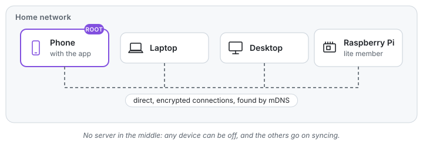
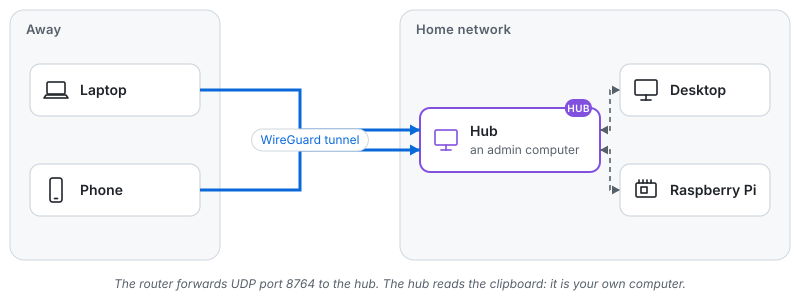
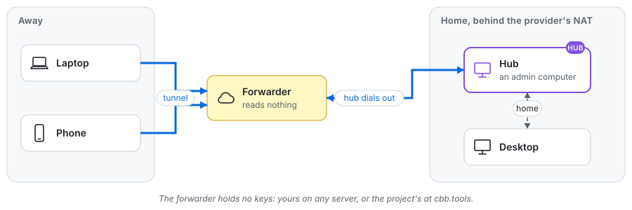
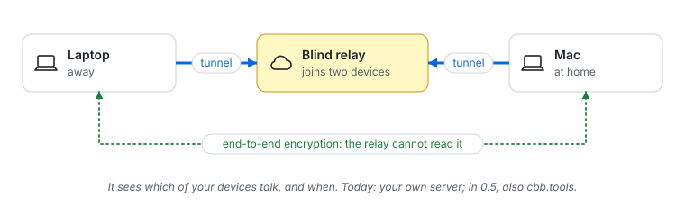

<!-- SPDX-License-Identifier: AGPL-3.0-only -->
# How it works

This page explains Clipboard Bridge in pictures: who is in a group, how the devices find
each other at home, and every way they can stay in touch when they are away. The exact
rules are in the [design](../design.md); you do not need them to use it.

## The group

Your devices form a **group**. Only devices you let in belong to it, and they talk only to
each other, always encrypted (TLS). Each device has a role:

| Role | Who | What it does |
|---|---|---|
| **Root** | the phone that made the group (or the computer, [without the app](without-app.md)) | holds the group's key, adds and removes devices, makes admins |
| **Admin** | a second phone, or a computer the root chose | adds and removes devices, like the root |
| **Member** | every computer and phone | syncs the clipboard |
| **Lite member** | a small Linux device: a router, a Raspberry Pi Zero | syncs, never adds anyone ([lite member](../../lite/README.md)) |
| **Hub** | one admin computer at home, if you want it | lets your devices sync when they are away from home |

The phone's key is made in its security chip (the Secure Enclave, Android's Keystore) and
never leaves it; each use asks for your face, fingerprint or passcode. A computer keeps its
keys in files that only Clipboard Bridge reads.

## At home: no hub needed

On one home network the devices find each other by themselves (mDNS) and connect directly.
Nothing leaves your network, and there is no server in the middle: any device can be off,
and the others go on syncing.

**Two networks at home**, for example a separate network for smart devices: mDNS does not
cross the router, so devices on different networks do not find each other by themselves.
The phone apps remember each computer's addresses from its QR code and still reach it; a
lite member can be told a computer's address (`cbb run -peer ADDRESS:8764`); and for
everything else a hub (below) joins both sides.

## Away from home: the hub

When a laptop or a phone leaves home, it needs a way back. One computer at home becomes
the group's **hub**: the devices that are away connect to it through the group's own
encrypted tunnel (WireGuard), and it passes the clipboard on to everyone at home.

- The hub is your own computer, a Linux machine or a Windows PC, and it must be an admin. A
  Mac cannot be the hub yet. The hub is a full member of the group: it reads the clipboard
  like any of your devices, which is why it must be yours.
- Your router forwards one UDP port (8764) to the hub, so the internet can reach it.
- The hub does not have to stay on. While it is off, nothing syncs away from home, and the
  devices at home still sync without it.
- Devices pick up the hub's details while they are at home, so turn sync away from home on
  before you leave.

Setting it up is in [Away from home](away-from-home.md).

## When the internet cannot reach your hub: a forwarder

Many internet providers put homes behind a shared address (carrier-grade NAT), and then no
port forward helps. The hub can instead register with a **forwarder**, a server on the
internet that passes the tunnel's encrypted packets between your devices and your hub. The
hub dials out to the forwarder, so nothing at home has to be opened.

The forwarder holds no keys and cannot read anything: it only sees encrypted packets going
to your hub. Two kinds:

- **Your own**: `cbb forward` on any server with a public address, a cheap virtual server
  for example ([running your own servers](../reference/self-hosting.md)).
- **The Clipboard Bridge forwarder** at `cbb.tools`, run by the project for everyone. It
  is being tested and not open to everyone yet; its address and key will be on this page
  when it opens.

Devices try the hub's own address first and the forwarder last.

## When the network blocks WireGuard

Some networks (hotels, offices, some countries) block VPN traffic. The hub can disguise the
group's tunnel:

- **Obfuscation** (`-obfuscate`): the tunnel speaks AmneziaWG, which does not look like
  WireGuard on the wire. Computers and both phone apps support it.
- **VLESS with REALITY** (`-vless`, through a forwarder): the devices reach the forwarder
  inside what looks like an ordinary HTTPS connection to a well-known website. For networks
  that block both of the above. Computers and both phone apps support it.

The lite member speaks only plain WireGuard, so with either of these it syncs at home only.

## No computer to be the hub

A group of just phones, or phones and a Mac, has no computer that can be the hub. Today
there are two choices:

- **Sync at home only.** Everything works on the home network.
- **A blind relay of your own** (`cbb relay` on your server). It stands in for the hub as
  the meeting point, but it is not a member: the devices' encryption runs end to end through
  it, so it cannot read the clipboard. It does see which of your devices talk, and when.
  Computers can use it; the phone apps cannot yet.

**Planned:**

- **The phone as the hub**, while its app is open (in 0.5). A group made on a phone will
  sync away from home without any computer, and the app will suggest moving the hub to a
  computer that is always on once one joins.
- **Several hubs** in one group (in 0.5): the first one online serves, in an order the root
  sets, so the group keeps working when one hub is off.
- **A blind relay at `cbb.tools`** for everyone who does not want to run a hub or a relay,
  and the relay in the phone apps (in 0.5). It will see which devices talk and when, never
  what they copy, and you turn it on yourself.

## What each server can see

| Server | Reads the clipboard | Knows which of your devices talk, and when | Whose it is |
|---|---|---|---|
| Hub | yes, it is your device | yes | yours |
| Forwarder | no | no: it sees the addresses encrypted packets come from and go to your hub | yours, or the project's at `cbb.tools` |
| Blind relay | no | yes | yours (the project's at `cbb.tools` in 0.5) |

Nothing else is involved: no accounts, no cloud, no telemetry. With sync away from home on,
a computer may reach only the home network and the group's own hub, forwarder and relay.
