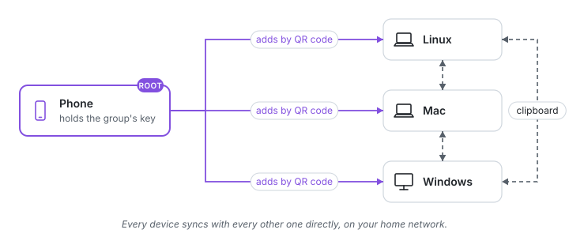

<!-- SPDX-License-Identifier: AGPL-3.0-only -->
# Quick start

Clipboard Bridge gives your phone and your computers one clipboard: copy on one, paste on
another. The devices form a **group** on your home network. The phone holds the group's key
and lets each new device in, so nobody can join without you.



It takes four steps: install the app, install Clipboard Bridge on a computer, scan the
computer's QR code, and turn on sharing on that computer.

A group can have a computer at its heart or be made of phones only: both work, and we recommend
a computer that is often on, which keeps sync away from home going at any time ([two kinds of group](how-it-works.md#two-kinds-of-group)).
With phones only, skip steps 2 to 4: on each other phone tap **I already use Clipboard Bridge
on another phone**, and scan the code it shows with **Connect a new device** on the first.

## 1. Install the app on your phone

- **Android** 10 or later: download `clipboardbridge-X.Y.Z.apk` from the
  [latest release](https://github.com/HunterEwok/clipboardbridge/releases/latest) on the
  phone and open it.
- **iPhone**: the app comes with TestFlight, which is not open yet. Until then an iPhone
  uses a shortcut, and a computer holds the group: see [Without the app](without-app.md).

Open the app. You will add the first computer in step 3.

## 2. Install Clipboard Bridge on a computer

Pick any computer on your home network: a laptop, a desktop, a Raspberry Pi.

On **Linux** or a **Mac**, in a terminal:

```sh
curl -fsSL https://github.com/HunterEwok/clipboardbridge/releases/latest/download/get.sh | sudo sh
```

On **Windows** 10 or 11, in a PowerShell opened with "Run as administrator":

```powershell
irm https://github.com/HunterEwok/clipboardbridge/releases/latest/download/get.ps1 | iex
```

The installer checks the download, starts Clipboard Bridge and asks before it opens the
firewall for it (answer `y`). Then log out and in again once, or open a new terminal on
Windows. Homebrew, winget, Docker and the details are in [Installing](install.md).

## 3. Add the computer

On the computer:

```sh
sudo cbb pair
```

On Windows, run `cbb pair` in the administrator terminal. It shows a QR code.

In the app, tap **Connect a new device** and scan the code. The app makes the group's key
(it asks for your fingerprint, face or passcode) and adds the computer. That's the group.

Add every other computer the same way: install, `sudo cbb pair`, and **+** in the app.

## 4. Share the computer's clipboard

A new computer keeps its clipboard to itself until you say otherwise. To make what you
copy on it reach the group, and what the group copies reach it:

```sh
sudo cbb mode shared
```

Now copy on the computer and paste on the phone, or the other way round:

- **Android** gets the computers' copies by itself. To send the phone's copies, tap the big
  button on the app's Home, the **Send clipboard** tile in Quick Settings or Send in the
  notification; or turn on **Send my copies by themselves** in the app to have it done for
  you.
- **Between computers** in shared mode: copy on one, paste on another. Nothing to press.

Other modes (only receive, only send) and the rest of what the apps do are in
[The apps](apps.md).

## 5. Recommended: let a computer that is always on help the phone

The group works with just the phone, but two things are better on a computer that stays on,
such as a home server, a Raspberry Pi or a desktop:

- **Make it an admin.** On the phone, tap the computer on Home and then
  **Make it an admin**. It can then add and remove devices too (`sudo cbb pair`,
  `sudo cbb revoke NAME`), so you do not need the phone at hand every time. The phone stays
  the group's root, its most trusted device: the root's key never leaves the phone's
  security chip.
- **Make it the hub**, so your devices keep syncing when they are away from home. See
  [Away from home](away-from-home.md).

Add a second phone too, so that losing one phone loses nothing: on the second phone tap
**I already use Clipboard Bridge on another phone** and scan its code with **+** on the
first. The first phone makes it an admin.

## What next

- [How it works](how-it-works.md): the group, the roles, and pictures of every way the
  devices connect, at home and away.
- [Away from home](away-from-home.md): sync from anywhere through a hub.
- [Without the app](without-app.md): a group held by a computer, and the iPhone shortcut.
- [Troubleshooting](troubleshooting.md), when something does not work.
