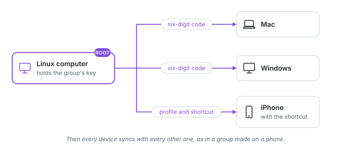

<!-- SPDX-License-Identifier: AGPL-3.0-only -->
# Without the app

A group does not need the phone app. A computer can hold the group instead, and an iPhone
without the app joins with a shortcut. This is also the way while the iPhone app waits for
TestFlight.



## 1. Make the group on a computer

[Install](install.md) Clipboard Bridge on a computer that is often on; a Linux machine if
you want the iPhone shortcut, since only Linux computers serve it. Then:

```sh
sudo cbb new
```

This computer is now the group's **root**: it holds the group's key and adds and removes
devices. Its key is a file on the computer, protected by the system; the phone app keeps
the same key in the phone's security chip instead.

## 2. Add computers

On the root:

```sh
sudo cbb pair
```

It shows a six-digit code and waits. On the new computer, also `sudo cbb pair`, and type
the code there. The new computer joins within seconds.

Then turn on sharing on each computer, as in the [quick start](quickstart.md#4-share-the-computers-clipboard):
`sudo cbb mode shared`.

## 3. Add an iPhone with the shortcut

On the root (it must be a Linux computer):

```sh
sudo cbb pair -phone
```

It prints a QR code, the start of a fingerprint and a six-digit code.

1. Scan the QR code with the iPhone's camera and follow the page: install the profile.
2. Check that the profile's fingerprint starts with the printed one (Settings, General,
   VPN & Device Management, "Clipboard Bridge", More Details), then turn on full trust for it
   (Settings, General, About, Certificate Trust Settings).
3. Add the shortcut "clipboardbridge" from the same page and run it once; it asks for the
   six-digit code.
4. Put the shortcut on the Action button, or on Back Tap (Settings, Accessibility, Touch,
   Back Tap, Double Tap).

One press then picks the direction by itself: something copied on a computer a moment ago
comes to the iPhone; otherwise a new copy on the iPhone goes to the computers.

## 4. Do not depend on one computer

Make a second computer an admin, so it can add and remove devices too:

```sh
sudo cbb admin NAME   # on the root; NAME as cbb status shows it, and it must be on
```

A Linux computer with a TPM keeps its admin key there. A Mac, a Windows PC or a Linux
computer without a TPM keeps it in a file, so `cbb admin` asks for `-allow-file-key` first:
whoever copies that file acts as an admin until another admin removes the computer, so make
an admin only of a computer you keep safe.

If the root is lost or broken, the admin takes the group over, and every other device stays:

```sh
sudo cbb takeover NAME       # on the admin; NAME is the lost root
```

iPhones with the shortcut pair again after a takeover. More in [if a device is lost or stolen](lost-device.md).

## Joining from another network

A computer that is not at home joins by an invitation from the hub
([Away from home](away-from-home.md#a-computer-that-is-not-at-home-an-invitation)), or
through a connection you already control:

- **SSH** to the root or an admin: on the new computer run
  `ssh -N -L 18764:localhost:8764 user@that-machine`, then `sudo cbb pair` there (in another
  SSH session) and `sudo cbb pair -code 127.0.0.1:18764` here.
- **Your own VPN** that gives both machines private addresses: `sudo cbb pair` on the root
  or an admin, then `sudo cbb pair -code ITS-VPN-ADDRESS:8764` here. On Linux, run the
  installer again after setting up the VPN, so its firewall rules allow the VPN's network.

The code never travels in the clear: the pairing runs inside SSH or your VPN, and inside
TLS. The new computer syncs through that path until its service restarts; to keep syncing
afterwards, turn on [sync away from home](away-from-home.md) on both before you close the
connection.

## A group from before 0.4

A group made before 0.4 has no root: every Linux and Windows member holds its keys. Once
every device runs 0.4 or later, give it a root, on one of them; nobody pairs again, except
iPhones with the shortcut:

```sh
sudo cbb upgrade
```
