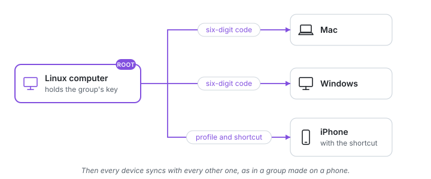

<!-- SPDX-License-Identifier: AGPL-3.0-only -->
# Without the app

A group of computers does not need the phone app: a computer can hold the group instead.



## 1. Make the group on a computer

[Install](install.md) Copy Beyond Borders on a computer that is often on: Linux, Windows, a
Mac or FreeBSD. It holds the group. Then:

```sh
sudo cbb new
```

This computer is now the group's **root**: it holds the group's key and adds and removes
devices. Its key is a file on the computer, protected by the system; the phone app keeps
the same key in the phone's security chip instead.

## 2. Add computers

On the root:

```sh
sudo cbb pair
```

It shows a six-digit code and waits. On the new computer, also `sudo cbb pair`: it shows a
QR code for the phone app first, which you can ignore, and asks for the code; type the six
digits there. The new computer joins within seconds.

Each computer then syncs, as in the [quick start](quickstart.md#4-copy-on-one-paste-on-another).

## 3. Do not depend on one computer

Make a second computer an admin, so it can add and remove devices too:

```sh
sudo cbb admin NAME                   # on the root; NAME as cbb status shows it, and it must be on
sudo cbb admin -allow-file-key NAME   # for a computer without a TPM or a Secure Enclave
```

A Linux computer or a Windows PC with a TPM keeps its admin key there, a Mac in its Secure
Enclave. A computer without either keeps it in a file, so `cbb admin` asks for `-allow-file-key` first:
whoever copies that file acts as an admin until another admin removes the computer, so make
an admin only of a computer you keep safe.

If the root is lost or broken, the admin takes the group over, and every other device stays:

```sh
sudo cbb takeover NAME       # on the admin; NAME is the lost root
```

More in [if a device is lost or stolen](lost-device.md).

## Joining from another network

A computer that is not at home joins by an invitation from the hub
([Away from home](away-from-home.md#a-computer-that-is-not-at-home-an-invitation)), or
through a connection you already control:

- **SSH** to the root or an admin: on the new computer run
  `ssh -N -L 18764:localhost:8764 user@that-machine`, then `sudo cbb pair` there (in another
  SSH session) and `sudo cbb pair -code 127.0.0.1:18764` here.
- **Your own VPN** that gives both machines private addresses: `sudo cbb pair` on the root
  or an admin, then `sudo cbb pair -code ITS-VPN-ADDRESS:8764` here. On Linux, run the
  installer again after setting up the VPN, so its firewall rules allow the VPN's network.

The code never travels in the clear: the pairing runs inside SSH or your VPN, and inside
TLS. The new computer syncs through that path until its service restarts; to keep syncing
afterwards, turn on [sync away from home](away-from-home.md) on both before you close the
connection.

## A group from before 0.6

0.6 reads only group records of version 2, and keeps no way back to older groups. A computer
updated from an earlier version leaves its old group at its first start: it moves the
group's files into `before-0.6` in its state directory, keeps its settings, and `cbb status`
says so. Set the group up again: `cbb new` on one computer, then `cbb pair` on the others.
